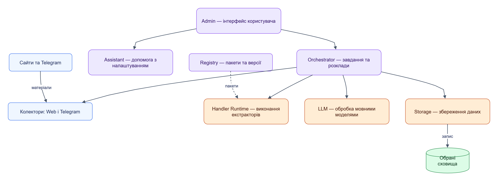
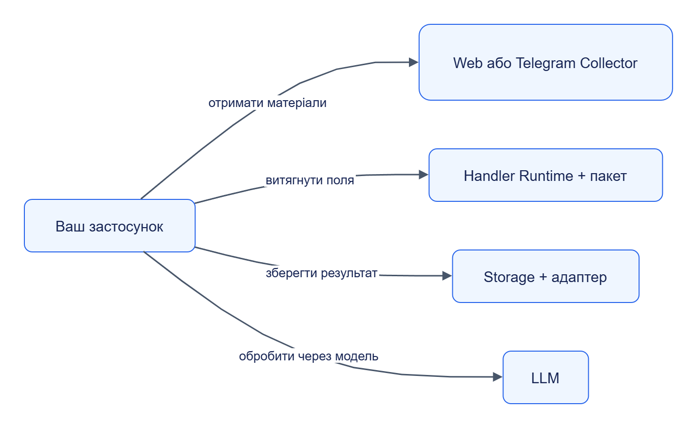
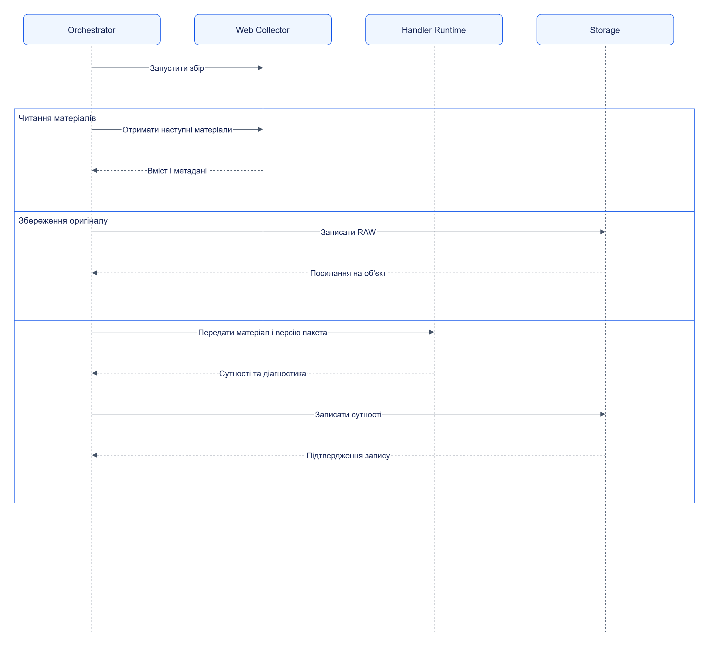
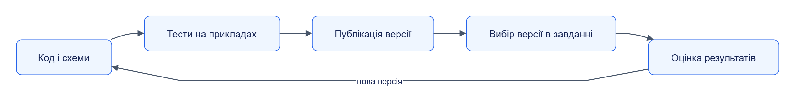

# Jane

**Модульна система збору та обробки даних.**

Jane отримує матеріали із сайтів і Telegram, витягує з них структуровані дані та зберігає результати. Кожен модуль виконує окрему роль: його можна підключити до власного застосунку або поєднати з іншими модулями Jane.

## Зміст

- [Можливості](#можливості)
- [Типи модулів](#типи-модулів)
- [Каталог модулів](#каталог-модулів)
- [Автономне використання](#автономне-використання)
- [Виконання завдання](#виконання-завдання)
- [Пакети обробників](#пакети-обробників)
- [Швидкий старт](#швидкий-старт)
- [Структура репозиторію](#структура-репозиторію)
- [Розробка та документація](#розробка-та-документація)

## Можливості

| Сценарій | Що робить Jane | Що отримує користувач |
|---|---|---|
| **Каталог товарів** | Збирає сторінки й витягує поля карток | Назви, ціни, наявність і посилання |
| **Відстеження змін** | Перевіряє вибрані поля за розкладом | Оновлені значення та історію спостережень |
| **Події з Telegram** | Отримує повідомлення й обробляє їх | Структуровані сутності з походженням |
| **Власна обробка** | Виконує підготовлений пакет обробника | Результат за заданою схемою |

Користувач задає **джерело → етапи обробки → сховище → розклад**. Через Admin можна налаштовувати завдання, редагувати та тестувати обробники, переглядати результати й помилки. Assistant використовує LLM для дослідження джерел і вдосконалення екстракторів.

### Будова платформи



[Темна тема](docs/diagrams/platform/readme-01.dark.png) · [Редаговане джерело Draw.io](docs/diagrams/platform/readme-01.drawio)

Схема показує основні зв’язки керування: Orchestrator викликає виконавців етапів. Registry також надає пакети правил колекторам і пакети обробникам Storage та LLM; Admin і Assistant працюють із публічними API сервісів.

## Типи модулів

- **Колектори** — отримують матеріали й метадані із зовнішніх джерел.
- **Обробники** — витягують поля, перетворюють дані, звертаються до LLM або зберігають результат.
- **Середовище виконання** — запускає код екстракторів і Python-перетворень в ізоляції.
- **Репозиторій обробників** — зберігає пакети, версії, тести та форки.
- **Оркестратор** — керує етапами, розкладами й станом виконання завдань.
- **Асистент** — допомагає підключати джерела та вдосконалювати обробку.
- **Адміністративний інтерфейс** — надає засоби керування, тестування й спостереження.
- **Бібліотеки та SDK** — надають спільні засоби розробки сервісів і екстракторів.

## Каталог модулів

| Модуль | Тип | Призначення |
|---|---|---|
| [Web Collector](services/web-collector/) | Колектор | Збір вебсторінок та інших матеріалів із сайтів |
| [Telegram Collector](services/telegram-collector/) | Колектор | Збір повідомлень, історії та редагувань |
| [Storage](services/storage/) | Обробник збереження | Запис оригіналів і результатів через адаптери |
| [LLM](services/llm/) | Обробник LLM | Виклики моделей через налаштованих провайдерів |
| [Handler Runtime](services/handler-runtime/) | Середовище виконання | Виконання пакетів екстракторів і перетворень |
| [Registry](services/registry/) | Репозиторій обробників | Публікація, версіонування та форкування пакетів |
| [Orchestrator](services/orchestrator/) | Оркестратор | Виконання завдань і контроль їхнього стану |
| [Assistant](services/assistant/) | Асистент | Дослідження джерел і вдосконалення екстракторів |
| [Admin](web/admin/) | Адміністративний інтерфейс | Керування платформою через браузер |
| [Extractor SDK](libs/extractor-sdk/) | SDK | Написання й тестування екстракторів |
| [Jane Kit](libs/jane-kit/) | Бібліотека | Спільні засоби для сервісів Jane |

**Адаптери сховищ:** [PostgreSQL](services/storage/adapters/postgres/), [SQL Server](services/storage/adapters/sqlserver/), [MongoDB](services/storage/adapters/mongodb/), [MinIO](services/storage/adapters/minio/), [S3](services/storage/adapters/s3/) і [файли](services/storage/adapters/files/).

## Автономне використання

Для прямого виклику колектора або обробника Orchestrator не потрібен. Власний застосунок обирає потрібні API й сам керує їхніми викликами.



[Темна тема](docs/diagrams/platform/readme-02.dark.png) · [Редаговане джерело Draw.io](docs/diagrams/platform/readme-02.drawio)

Кожна стрілка — самостійний варіант інтеграції. Можна взяти один сервіс, побудувати власний ланцюжок або передати керування процесом Orchestrator.

| Компонент | Що потрібно для його сценарію |
|---|---|
| Колектор | Джерело та правила збору; для реального Telegram — налаштована сесія |
| Handler Runtime | Пакет, вхідні дані та середовище виконання, типово Docker |
| Storage | Адаптер і цільове сховище |
| LLM | Налаштований провайдер і доступ до моделі |
| Registry | Потрібен для отримання пакетів із репозиторію; Runtime може прийняти локальний пакет |

Сервіси можуть мати власні сховища службового стану. Вони обмінюються даними через версіоновані API й не читають внутрішні таблиці один одного. Власна реалізація може замінити модуль, якщо дотримується його контракту.

**Контракти:** [колектор](contracts/openapi/collector.v1.yaml) · [обробник](contracts/openapi/handler.v1.yaml) · [оркестратор](contracts/openapi/orchestrator.v1.yaml).

## Виконання завдання

Приклад — зібрати картку товару, зберегти оригінал і записати витягнуті поля.



[Темна тема](docs/diagrams/platform/readme-03.dark.png) · [Редаговане джерело Draw.io](docs/diagrams/platform/readme-03.drawio)

Orchestrator передає дані між етапами. Збереження оригіналу є окремим етапом, а завдання може мати кілька гілок обробки. Тривалі операції повертають ідентифікатор для отримання стану й результату.

| Поняття | Значення |
|---|---|
| **Матеріал** | Оригінальний вміст — RAW — разом із метаданими джерела |
| **Сутність** | Структуровані поля: наприклад, назва товару, ціна та URL |
| **Обробник** | Операція над переданими даними |
| **Завдання** | Джерело, етапи обробки, параметри та розклад |

## Пакети обробників

Екстрактор — пакет із конкретною логікою витягування даних. Handler Runtime — сервіс, який виконує його код. Приклади пакетів: [картка товару](examples/packages/examples.testsite-catalog-extractor/) та [перевірка ціни](examples/packages/examples.testsite-price-extractor/).

Пакет містить логіку обробки, схеми входів і виходів, параметри та тестові приклади. Робочий цикл автора пакета:



[Темна тема](docs/diagrams/platform/readme-04.dark.png) · [Редаговане джерело Draw.io](docs/diagrams/platform/readme-04.drawio)

Етап завдання посилається на конкретну версію пакета. Зміни публікуються новою версією. Форк зберігає походження, але розвивається незалежно; перенесення змін батьківського пакета виконується за явною командою користувача. Облікові дані налаштовуються окремо від пакета.

## Швидкий старт

Демо збирає товари з тестового сайту й перевіряє оновлення цін. Потрібні **uv**, **Docker із Compose v2** та **just**; версія Python задана в [.python-version](.python-version). Команди виконуються з кореня репозиторію на Windows або Linux.

### 1. Підготовка

```powershell
uv tool install rust-just
uv sync --all-packages
```

### 2. Запуск демостенда

```powershell
uv run --all-packages python deploy/profiles/stack.py up --project jane-demo --profile dev-laptop
```

Буде запущено тестовий сайт, Registry, Storage, Handler Runtime, Web Collector, Orchestrator і потрібну інфраструктуру.

### 3. Збір і перевірка результату

```powershell
uv run --all-packages python examples/jane_examples.py demo --project jane-demo
```

Приклад публікує пакети, налаштовує завдання, збирає каталог, перевіряє ціни й збережені дані. Ключові поля успішного підсумку:

```json
{
  "ok": true,
  "failures": []
}
```

Підсумок також містить кількість матеріалів `raw_objects`, кількість сутностей `entities` та ідентифікатори запусків.

### 4. Адреси сервісів

```powershell
uv run --all-packages python deploy/profiles/stack.py env --project jane-demo
```

Порти призначаються під час запуску. Для паралельного демостенда виберіть іншу назву проєкту й використовуйте її в усіх командах.

### 5. Прибирання

Команда видаляє демостенд **разом із його тестовими даними**:

```powershell
uv run --all-packages python deploy/profiles/stack.py down --project jane-demo
```

## Структура репозиторію

```text
Jane/
├── services/
│   ├── web-collector/        # Збір із сайтів
│   ├── telegram-collector/   # Збір із Telegram
│   ├── handler-runtime/      # Виконання екстракторів і перетворень
│   ├── storage/              # Збереження та адаптери сховищ
│   ├── llm/                  # Виклики мовних моделей
│   ├── registry/             # Пакети та версії
│   ├── orchestrator/         # Завдання та розклади
│   └── assistant/            # Допомога з налаштуванням
├── libs/                     # Jane Kit та Extractor SDK
├── web/admin/                # Адміністративний інтерфейс
├── contracts/                # OpenAPI, JSON Schema, Python-контракти
├── examples/                 # Пакети та сценарії використання
├── infra/                    # Локальна інфраструктура
├── deploy/                   # Розгортання та профілі лімітів
├── templates/                # Шаблони сервісів
├── tests/                    # Спільні тести та тестовий сайт
├── scripts/                  # Засоби розробки
└── docs/                     # Документація
```

Код і тести модуля розташовані в його каталозі. Формати даних описані в [JSON Schema](contracts/schemas/), HTTP API — в [OpenAPI](contracts/openapi/).

## Розробка та документація

### Перевірки й розширення

| Команда | Призначення |
|---|---|
| `just check` | Код, типи, unit-тести, контракти та вебпроєкт |
| `just test web-collector` | Тести вибраного модуля |
| `just integration` | Інтеграційні перевірки |
| `just e2e` | Наскрізні сценарії |
| `just contracts-check` | Перевірка контрактів |
| `just new-service <name>` | Створення сервісу з шаблону |

Команди визначені в [justfile](justfile). Для розробки Admin потрібні також Node.js версії з [.node-version](.node-version) і pnpm версії з [package.json](web/admin/package.json).

### Основні документи

| Документ | Що містить |
|---|---|
| [Технічне завдання](TECHNICAL_SPECIFICATION.md) | Призначення, принципи та вимоги до системи |
| [Правила роботи](AGENTS.md) | Порядок внесення змін у репозиторій |
| [Вимоги до документації](DOCUMENTATION_REQUIREMENTS.md) | Розділи, довідники модулів і діаграми |
| [План документації](DOCUMENTATION_PLAN.md) | Пакети робіт, залежності та критерії готовності |

---

Проєкт названо на честь докторки Джейн Гудолл. Jane не має офіційного зв’язку з Jane Goodall Institute.
