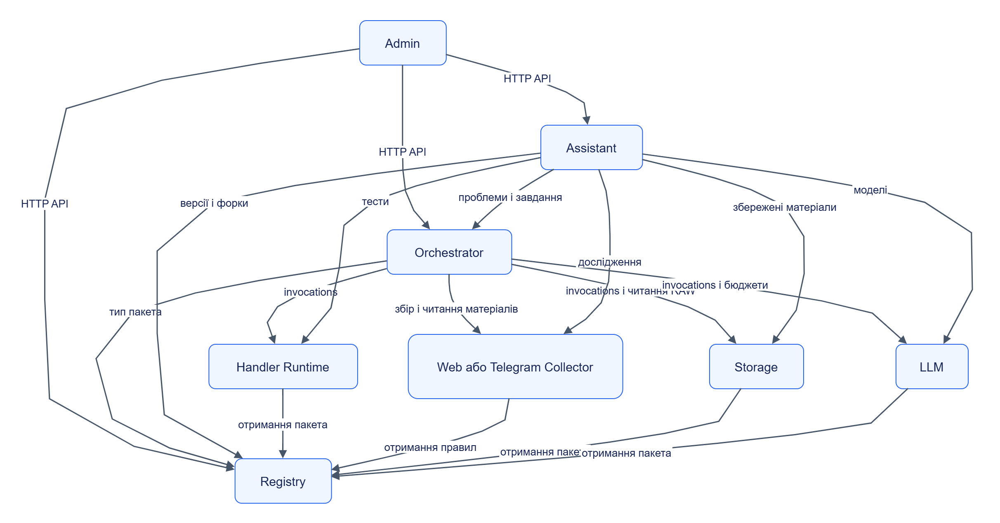

# Архітектура Jane

**Jane складається з автономних сервісів із версіонованими контрактами.** Orchestrator поєднує їх у завдання, а сторонній застосунок може викликати потрібні модулі напряму.

## Зміст

- [Межі компонентів](#межі-компонентів)
- [Взаємодія сервісів](#взаємодія-сервісів)
- [Архітектурні принципи](#архітектурні-принципи)
- [Розділи архітектури](#розділи-архітектури)

## Межі компонентів

| Компонент | Власна відповідальність | Публічний контракт |
|---|---|---|
| Web і Telegram Collectors | Збір, ревізії, буфер і курсори матеріалів | [collector.v1](../../contracts/openapi/collector.v1.yaml) |
| Handler Runtime | Вибір профілю й виконання коду пакета в ізоляції | [handler.v1](../../contracts/openapi/handler.v1.yaml) |
| Storage | Збереження через адаптери, ідемпотентна доставка, порядок полів | [storage.v1](../../contracts/openapi/storage.v1.yaml), [handler.v1](../../contracts/openapi/handler.v1.yaml) |
| LLM | Провайдери, моделі, виклики, облік і бюджети | [llm.v1](../../contracts/openapi/llm.v1.yaml), [handler.v1](../../contracts/openapi/handler.v1.yaml) |
| Registry | Артефакти пакетів, версії та форки | [registry.v1](../../contracts/openapi/registry.v1.yaml) |
| Orchestrator | Конфігурація, DAG, розклади, черга, повторні спроби | [orchestrator.v1](../../contracts/openapi/orchestrator.v1.yaml) |
| Assistant | Дослідження джерел і підготовка змін пакетів | [assistant.v1](../../contracts/openapi/assistant.v1.yaml) |
| Admin | Робота користувача з публічними API | [клієнт](../../web/admin/src/api/client.ts) |

## Взаємодія сервісів

Схема показує основні **виклики сервісів**. Стрілка від колектора до екстрактора тут відсутня: типовий процес передає дані через Orchestrator.

[Темна тема](../diagrams/platform/architecture-readme-01.dark.png) · [Редаговане джерело Draw.io](../diagrams/platform/architecture-readme-01.drawio)

Admin також викликає API колекторів, обробників і підключень через конфігуровані адреси. Схема виділяє основні маршрути; фактичні адреси та ролі виконавців задаються [налаштуваннями Orchestrator](../../services/orchestrator/src/jane_orchestrator/settings.py), [клієнтами Assistant](../../services/assistant/src/jane_assistant/clients.py) та [конфігурацією Admin](../../web/admin/src/config.ts).

## Архітектурні принципи

- **Автономність:** сервіс приймає дані через контракт; Orchestrator є одним із клієнтів.
- **Власність стану:** сервіс керує власними таблицями й файлами. Дані сусіднього сервісу читаються через API; дозволений доступ до blob є частиною передавання вмісту.
- **Явна композиція:** джерела, пакети, версії, етапи й підключення визначають конфігурацію завдання.
- **Повторювана доставка:** повторна спроба використовує той самий ключ. Нове спостереження має власний ідентифікатор.
- **Обмежене виконання:** ресурси, час, черги, передавання та витрати налаштовуються й перевіряються на вході.
- **Простежуваність:** матеріал, спостереження, виклик, етап, запуск і версія пакета зв’язують результат із походженням.

Вимоги: [ТЗ §4–§11](../../TECHNICAL_SPECIFICATION.md). Зафіксовані рішення: [ADR](../adr/README.md).

## Розділи архітектури

| Розділ | Що пояснює |
|---|---|
| [Автономність та контракти](autonomy.md) | Пряме використання, обов’язкові залежності, заміна реалізації |
| [Дані та власність](data.md) | Матеріали, сутності, RAW, blob і службові сховища |
| [Виконання та надійність](execution.md) | Реальні API-виклики, асинхронність, підтвердження й повторні спроби |
| [Безпека](security.md) | Автентифікація, права, секрети, зовнішні дані й пісочниця |
| [Розгортання та ліміти](deployment.md) | Локальний стенд, профілі, спадкування й кілька екземплярів |
| [Карта репозиторію](repository-map.md) | Папки, ключові файли й точки входу |
| [Відповідність ТЗ](conformance.md) | Реалізація, обмеження та стан архітектурних рішень |
| [Діаграми платформи](../diagrams/platform/README.md) | Індекс схем і їхніх редагованих джерел |

Перевірена основа: `91876d1`, 2026-10-11; [звіт DOC-04](../delivery/documentation/DOC-04.md).
