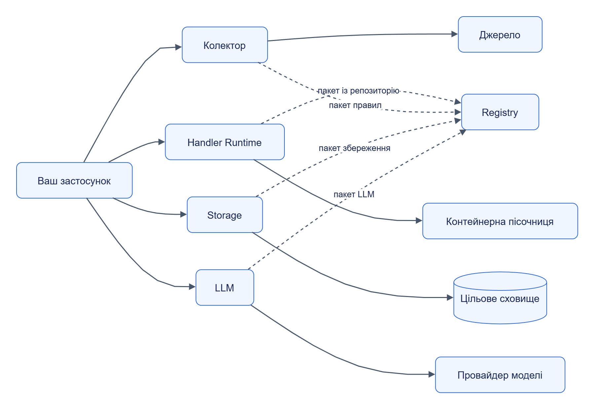

# Автономність та контракти

Модуль Jane можна використовувати зі стороннього застосунку через його API або бібліотечний інтерфейс. Повний склад платформи для такого виклику не потрібен.

## Зміст

- [Мінімальна композиція](#мінімальна-композиція)
- [Залежності](#залежності)
- [Межі контракту](#межі-контракту)
- [Заміна реалізації](#заміна-реалізації)

## Мінімальна композиція

Кожна гілка схеми — окремий варіант використання. Пунктир означає залежність сценарію, яку можна усунути локальним пакетом або власною конфігурацією.

[Темна тема](../diagrams/platform/architecture-autonomy-01.dark.png) · [Редаговане джерело Draw.io](../diagrams/platform/architecture-autonomy-01.drawio)

Приклад мінімальної автономної обробки: встановлений [Extractor SDK](../components/extractor-sdk/README.md), локальний пакет та [CLI Handler Runtime](../../services/handler-runtime/src/jane_handler_runtime/cli.py). Для HTTP-сценарію Runtime виконує той самий тип пакета через `handler.v1`.

## Залежності

| Модуль | Потрібне для сценарію | Умовні залежності |
|---|---|---|
| Web Collector | Доступне джерело, правила, власний каталог стану | Registry для посилання на пакет правил; браузер для JS-render |
| Telegram Collector | Налаштовані канали й власний стан | Реальна Telegram-сесія; Registry для пакета правил |
| Handler Runtime | Пакет, входи, дозволений профіль пісочниці | Registry для віддаленого пакета; PostgreSQL для спільного довговічного стану |
| Storage | Обраний адаптер, ціль і підключення | Registry для пакета; файловий том для files-адаптера |
| LLM | Провайдер, модель і підключення | Registry для пакета LLM; PostgreSQL для спільного стану |
| Registry | База метаданих і blob-сховище артефактів | PostgreSQL або memory; S3/MinIO або файловий blob backend |
| Orchestrator | Власний PostgreSQL та налаштовані виконавці | Лише модулі, потрібні етапам конкретного завдання |
| Assistant | Набір API для вибраного workflow | Колектор, LLM, Registry, Runtime, Orchestrator або Storage за сценарієм |
| Admin | Адреси потрібних API | Провайдер OIDC за вибраного режиму входу |

Коли залежність недоступна, виклик завершується контрактною помилкою або повторюється за заданою політикою. Заміна Registry локальним пакетом усуває саме віддалене отримання пакета; пісочниця й стан Runtime залишаються окремими залежностями.

Джерела: [settings сервісів](../../services/), [package resolution Runtime](../../services/handler-runtime/src/jane_handler_runtime/packages.py), [Registry store](../../services/registry/src/jane_registry/store.py).

## Межі контракту

| Питання | Правило |
|---|---|
| Версія HTTP API | Шляхи `/v1`; машинозчитувані [OpenAPI](../../contracts/openapi/) |
| Формати входів і виходів | [JSON Schema](../../contracts/schemas/) і [Python Protocol](../../contracts/python/src/jane_contracts/) |
| Тривала операція | `202` із Job; читання стану та скасування через jobs API |
| Помилка | `application/problem+json` із кодом, деталями та ознакою повторної спроби |
| Повторна доставка | `Idempotency-Key`; стабільний ключ і узгоджене тіло запиту |
| Великі дані | ContentRef із розміром, хешем і дозволеним способом читання |
| Велика колекція | Курсорна пагінація; клієнт читає сторінки до завершення |
| Права | Bearer-токен і scope конкретної операції |

Спільні операції health, info, jobs та метрики визначає [Jane Kit](../../libs/jane-kit/src/jane_kit/service.py). Сервіс може реалізовувати кілька контрактів: Storage і LLM є виконавцями `handler.v1` та мають власні API.

## Заміна реалізації

Сумісний модуль повинен відтворити формати, семантику помилок, ідемпотентність, jobs, права та ліміти потрібного контракту. Збігу URL і HTTP-коду недостатньо: наприклад, підтвердження запису має зберігати семантику повторної доставки й порядку спостережень.

Для підключення виконавця Orchestrator використовує його роль і capabilities. Вибір колектора та обробника реалізовано в [Executors](../../services/orchestrator/src/jane_orchestrator/executors.py); логіка етапу описана в [TaskConfig](../../contracts/schemas/task-config.schema.json).

Рішення: [ADR-0001](../adr/0001-autonomous-modules.md). Далі: [виконання](execution.md) · [дані](data.md).
