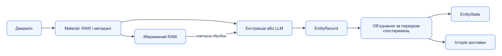
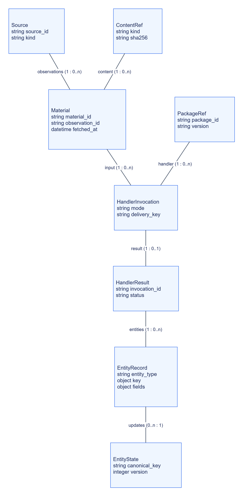

# Дані та власність

Jane відділяє матеріал джерела, результат обробки, службовий стан сервісу й цільове сховище. Це дозволяє змінити спосіб обробки або збереження, зберігаючи походження даних.

## Зміст

- [Логічний рух даних](#логічний-рух-даних)
- [Зв’язки документів](#звязки-документів)
- [Власники сховищ](#власники-сховищ)
- [Передавання вмісту](#передавання-вмісту)
- [Оновлення сутностей](#оновлення-сутностей)

## Логічний рух даних

Схема показує **перетворення даних**, а не прямі HTTP-виклики. Керування типовим процесом виконує Orchestrator.

[Темна тема](../diagrams/platform/architecture-data-01.dark.png) · [Редаговане джерело Draw.io](../diagrams/platform/architecture-data-01.drawio)

Збереження RAW задається окремим етапом. Матеріал без такого етапу може існувати лише в буфері колектора або як тимчасовий blob. Повторна обробка збереженого RAW читає його через [storage.v1](../../contracts/openapi/storage.v1.yaml).

## Зв’язки документів

Це модель **контрактних документів**, а не таблиць спільної бази. Зв’язки між сервісами зберігаються через ідентифікатори й API, без міжсервісних зовнішніх ключів.

[Темна тема](../diagrams/platform/architecture-data-02.dark.png) · [Редаговане джерело Draw.io](../diagrams/platform/architecture-data-02.drawio)

Поля у схемі — вибрані для пояснення зв’язків. `delivery_key` належить вкладеному `HandlerInvocation.delivery`, а `key` є об’єктом з `scope` і `natural`. Повні декларації: [Material](../../contracts/schemas/material.schema.json), [HandlerInvocation](../../contracts/schemas/handler-invocation.schema.json), [HandlerResult](../../contracts/schemas/handler-result.schema.json), [Entity](../../contracts/schemas/entity.schema.json).

## Власники сховищ

| Власник | Службовий стан | Механізм у поточному коді |
|---|---|---|
| Web Collector | Frontier, URL, стратегії, буфер, jobs | SQLite у `state_dir`; [settings](../../services/web-collector/src/jane_web_collector/settings.py) |
| Telegram Collector | Запуски, курсори каналів, ревізії, буфер, jobs | SQLite у `state_dir`; [settings](../../services/telegram-collector/src/jane_telegram_collector/settings.py) |
| Orchestrator | Джерела, завдання, запуски, items, розклади, синхронізація | Власний PostgreSQL; [db](../../services/orchestrator/src/jane_orchestrator/db.py) |
| Registry | Пакети, версії, походження й посилання на артефакти | Метадані у власному PostgreSQL або memory; артефакти S3/MinIO чи files; [store](../../services/registry/src/jane_registry/store.py), [blobs](../../services/registry/src/jane_registry/blobs.py) |
| Handler Runtime | Jobs, результати та ключі ідемпотентності | Власний PostgreSQL за `state_dsn`, інакше memory; [state](../../services/handler-runtime/src/jane_handler_runtime/state.py) |
| LLM | Підключення, моделі, jobs, використання й бюджети | PostgreSQL або memory; [store](../../services/llm/src/jane_llm/store.py) |
| Assistant | Сесії, jobs і ключі ідемпотентності | Власний PostgreSQL за `state_dsn`, інакше memory; [state](../../services/assistant/src/jane_assistant/state.py) |
| Storage | RAW, поточний стан, історія та доставка | Обраний адаптер; [engine](../../services/storage/src/jane_storage/engine.py) |

У dev-стенді PostgreSQL може бути одним сервером, але кожний сервіс отримує **власну базу й роль**. [Provisioning](../../infra/postgres/provision.sql) відкликає `PUBLIC`-доступ до цих баз. Сервісні DSN у [Compose](../../infra/compose.yaml) спрямовані на відповідного власника.

## Передавання вмісту

| Форма ContentRef | Як читати | Перевірки |
|---|---|---|
| `inline` | Вміст у документі, UTF-8 або base64 | Формат, розмір, хеш за наявності |
| `blob` із `file:///` | Файл у дозволеному корені | Розв’язаний шлях, тип файлу, розмір і SHA-256 |
| `blob` із `download_url` | Потокове завантаження з дозволеного хоста | Allowlist, тайм-аут, розмір і SHA-256 |
| Постійний об’єкт адаптера | Читання через Storage, далі передавання ContentRef | Політика Storage та споживача |

[ContentWriter](../../libs/jane-kit/src/jane_kit/content.py) обирає inline або транзитний файл за `transfer.inline_max_bytes` і режимом передавання. Транзитний об’єкт має `expires_at`; виробник очищує його за `transfer.transit_ttl_seconds`. Постійне збереження виконує Storage.

Читач не отримує облікові дані сховища з ContentRef. Сам `s3://` без дозволеного download URL поточний ContentReader не читає. На одному вузлі можна передавати файли через явно змонтований том; на різних вузлах потрібен доступний споживачам спосіб завантаження або узгоджений файловий транспорт.

У dev-стенді Runtime і LLM монтують дозволені об’єктні каталоги Storage лише для читання. Це транспорт вмісту за контрактом; таблиці, індекси й службові дані Storage не стають їхньою залежністю. Політика шляхів задана в [Compose](../../infra/compose.yaml) та [ContentReader](../../libs/jane-kit/src/jane_kit/content.py).

## Оновлення сутностей

- Поле в `fields` встановлює значення.
- Відсутнє поле зберігає попереднє значення.
- Поле в `cleared` явно очищується; `null` не використовується як команда очищення.
- Кожне поле пам’ятає порядок останнього спостереження; запізніле оновлення потрапляє до історії й позначається як stale.
- Запис версії виконується з контролем конкурентного оновлення; повторна технічна доставка розпізнається за ключем.

Правила реалізовані у [merge](../../services/storage/src/jane_storage/merge.py), порядок визначений [контрактом адаптера](../../contracts/python/src/jane_contracts/storage_adapter.py). Результат запису містить `applied_fields`, `stale_fields` і статус підтвердження.

Рішення: [ADR-0004](../adr/0004-content-refs.md), [ADR-0007](../adr/0007-reliable-delivery.md). Далі: [виконання](execution.md) · [безпека](security.md).
