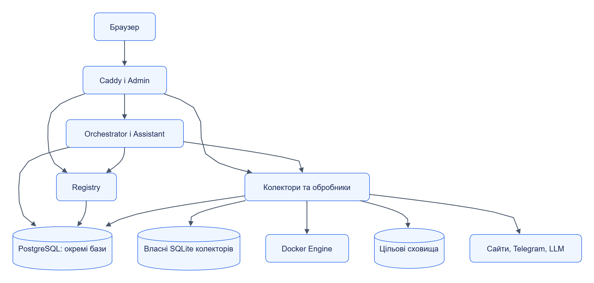

# Розгортання та ліміти

Склад стенда залежить від сценарію: автономний модуль запускається зі своїми залежностями, а платформа додає Orchestrator, Admin і потрібних виконавців.

## Зміст

- [Приклад локальної топології](#приклад-локальної-топології)
- [Профілі ресурсів](#профілі-ресурсів)
- [Спадкування лімітів](#спадкування-лімітів)
- [Кілька екземплярів](#кілька-екземплярів)
- [Що перевіряти при масштабуванні](#що-перевіряти-при-масштабуванні)

## Приклад локальної топології

Схема відтворює основні групи dev-стенда в [infra/compose.yaml](../../infra/compose.yaml). Кожна сервісна база належить своєму модулю, хоча фізичний PostgreSQL-сервер спільний.

[Темна тема](../diagrams/platform/architecture-deployment-01.dark.png) · [Редаговане джерело Draw.io](../diagrams/platform/architecture-deployment-01.drawio)

Група «колектори та обробники» містить різні сервіси: SQLite потрібен колекторам, Docker Engine — Runtime, а цільові сховища — Storage. Схема не означає, що кожен сервіс має всі ці залежності.

Compose-профілі дозволяють вибрати потрібні application services. Проєкт стенда визначає окремі назви контейнерів, мереж і томів. Скрипти [stack.py](../../deploy/profiles/stack.py) і [devstack](../../libs/jane-kit/src/jane_kit/devstack.py) призначають порти та готують конфігурацію.

## Профілі ресурсів

| Профіль | Джерело | Призначення |
|---|---|---|
| `dev-laptop` | [JSON](../../deploy/profiles/dev-laptop.json) | Локальний стенд із обмеженими ресурсами |
| `ci` | [JSON](../../deploy/profiles/ci.json) | Контрольований тестовий запуск |
| `single-node` | [JSON](../../deploy/profiles/single-node.json) | Початкове налаштування одного вузла |

Числові значення зберігаються у профілі, а не в цій сторінці. [Compose overlay](../../deploy/profiles/compose.stack.yaml) монтує файл лімітів у сервіси. [Harness](../../deploy/profiles/harness/limits_harness.py) та [thresholds](../../deploy/profiles/thresholds.json) задають спосіб вимірювання й пороги перевірки; фактичні результати окремого запуску мають зберігатися як докази.

## Спадкування лімітів

Порядок уточнення: **платформа → джерело → завдання → етап → запит**. Нижчий рівень перевизначає задані поля, а платформні `hard_caps` обмежують числові значення. Відсутнє поле успадковується; `null` не є способом успадкування.

| Група | Що обмежує |
|---|---|
| `concurrency` | Кількість запусків і паралельних items |
| `rate`, `crawl`, `telegram` | Частоту, область і обсяг отримання матеріалів |
| `timeouts`, `retries` | Час операцій і політику повторних спроб |
| `queue` | Буфер і непідтверджені матеріали |
| `sandbox` | CPU, пам’ять, процеси, час і вихід коду |
| `llm` | Витрати та частоту звернень до моделей |
| `transfer` | Розміри inline/blob та строк життя транзитного вмісту |

EffectiveLimits містить фінальні значення й `provenance`, тобто рівень, з якого походить кожне поле. Контракт: [limits.schema.json](../../contracts/schemas/common/limits.schema.json). Реалізація: [Orchestrator merge_limits](../../services/orchestrator/src/jane_orchestrator/limits.py) та [Jane Kit resolve_limits](../../libs/jane-kit/src/jane_kit/config.py).

Профіль лімітів і апаратні обмеження контейнера виконують різні функції. Профіль визначає політику операції; CPU/RAM доступні лише в межах фактичного вузла й контейнера. Підвищення ліміту не додає апаратних ресурсів.

## Кілька екземплярів

| Модуль | Координація | Умова |
|---|---|---|
| Orchestrator | PostgreSQL-черга, row locks, leases і heartbeat | Усі екземпляри використовують базу цього сервісу |
| Registry | PostgreSQL й незмінні версії | Спільна власна база та blob-сховище; memory — один процес |
| Runtime, Assistant | Jobs та ідемпотентні claims у PostgreSQL | Налаштований `state_dsn`; без нього стан memory |
| LLM | PostgreSQL state, budgets та claims | `store: postgres`; memory — тестовий режим |
| Web, Telegram | SQLite claims і leases | Спільний файл власного стану з підтримуваними файловими блокуваннями |
| Storage | Координація доставки й версій у вибраному адаптері | Спільна ціль і можливості конкретного backend |

Поточний код колекторів підтверджує модель кількох процесів зі спільним SQLite-файлом. Автоматичного переходу на розподілену базу або безумовної підтримки довільної мережевої файлової системи він не дає.

Джерела: [Web state](../../services/web-collector/src/jane_web_collector/state.py), [Telegram state](../../services/telegram-collector/src/jane_telegram_collector/state.py), [Engine](../../services/orchestrator/src/jane_orchestrator/engine.py), [PostgreSQL stores](../../libs/jane-kit/src/jane_kit/stores/postgres.py), [контракт адаптера](../../contracts/python/src/jane_contracts/storage_adapter.py).

## Що перевіряти при масштабуванні

1. Доступ усіх екземплярів до власного стану сервісу й однакову конфігурацію claims.
2. Шлях доставки blob: спільний том або дозволений download URL.
3. Ресурси цілі, з’єднання, транзакції та семантику адаптера.
4. Ліміти зовнішнього джерела й провайдера, які діють сумарно.
5. Узгоджені heartbeat, lease та тайм-аути.
6. Відновлення після зупинки працівника й повторної доставки.

Рішення: [ADR-0008](../adr/0008-limits-and-scaling.md). Практичні процедури: [експлуатація](../operations/README.md).
