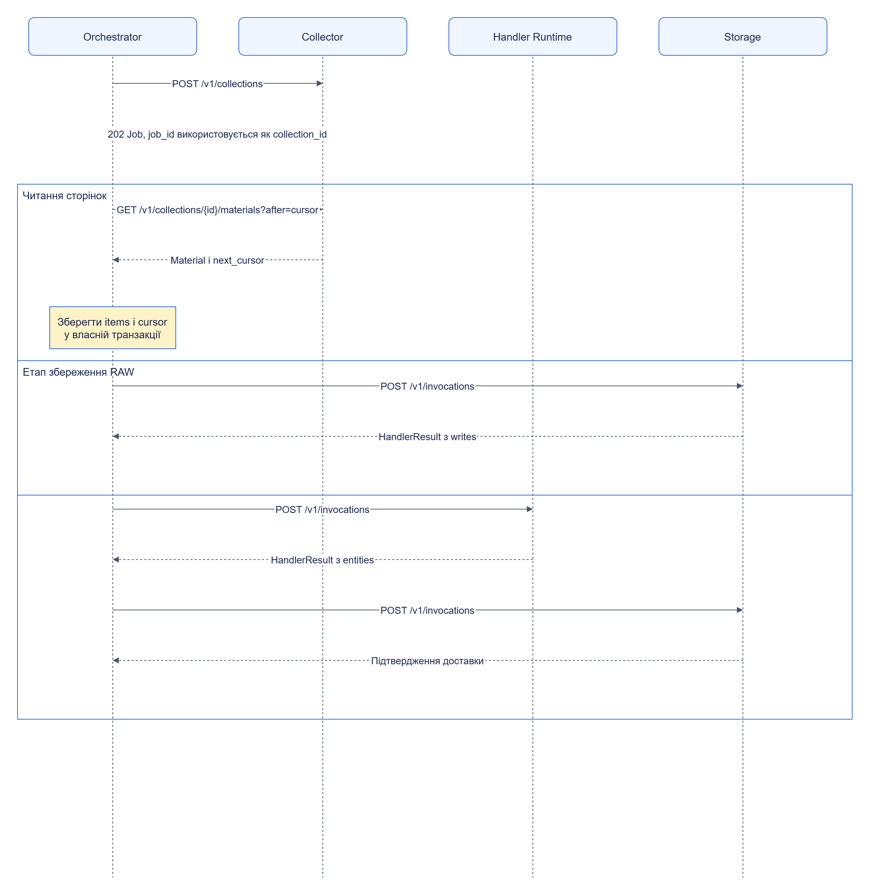
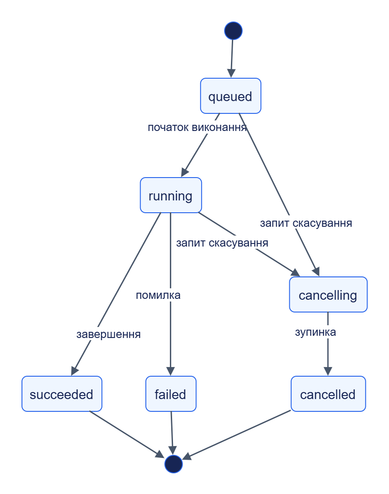

# Виконання та надійність

Orchestrator фіксує конфігурацію запуску, читає матеріали й передає їх виконавцям етапів. Черга та ключі доставки дозволяють повторити технічний виклик після збою.

## Зміст

- [Типовий процес](#типовий-процес)
- [Асинхронні операції](#асинхронні-операції)
- [Підтвердження та повторні спроби](#підтвердження-та-повторні-спроби)
- [Черга та розгалуження](#черга-та-розгалуження)
- [Простежуваність](#простежуваність)

## Типовий процес

Приклад показує фактичні API-ролі: збір, окреме збереження RAW, екстракцію та запис сутностей. Політика cursor-acknowledgement підтверджує попередню сторінку після запису матеріалів у власну чергу Orchestrator.

[Темна тема](../diagrams/platform/architecture-execution-01.dark.png) · [Редаговане джерело Draw.io](../diagrams/platform/architecture-execution-01.drawio)

Стрілки зі Storage та Runtime зображають успішну синхронну відповідь для стислості. Orchestrator надсилає `mode: sync`, але обробляє також `202` із Job і опитує його до завершення. Це реалізовано в [Engine._invoke](../../services/orchestrator/src/jane_orchestrator/engine.py).

Поля та точні шляхи збору: [collector.v1](../../contracts/openapi/collector.v1.yaml). Формат виклику: [HandlerInvocation](../../contracts/schemas/handler-invocation.schema.json). Налаштування етапів: [TaskConfig](../../contracts/schemas/task-config.schema.json).

## Асинхронні операції

`202 Accepted` означає прийняття операції, а її підсумок визначається станом Job. Клієнт читає `/v1/jobs/{job_id}` за API сервісу, який створив Job.

[Темна тема](../diagrams/platform/architecture-execution-02.dark.png) · [Редаговане джерело Draw.io](../diagrams/platform/architecture-execution-02.drawio)

Діаграма показує основний життєвий цикл з [JobStatus](../../contracts/schemas/common/job.schema.json). Окрема реалізація може завершити операцію раніше — наприклад, скасувати queued Job одразу; це не додає нового стану. Точні переходи спільного менеджера задані у [jobs.py](../../libs/jane-kit/src/jane_kit/jobs.py).

Job зі станом `succeeded` може містити HandlerResult зі статусом `empty` або `unrecognized`: операція виконалася, але зміст результату потребує окремої оцінки. Для обробника статус `failed` має діагностику причини.

## Підтвердження та повторні спроби

| Механізм | Поведінка |
|---|---|
| Lease | Працівник займає item, регулярно продовжує право на виконання |
| Відновлення | Прострочений lease дозволяє іншому працівнику продовжити роботу |
| Idempotency-Key | Повторна спроба використовує той самий ключ і стабільне тіло запиту |
| `idempotency_in_progress` | Orchestrator очікує або відкладає item, зберігаючи ключ доставки |
| Retry policy | Retryable-помилки повторюються з backoff у налаштованих межах |
| Storage acknowledgement | Підтвердження містить статус запису, дубля або застарілого спостереження |
| Скасування | Orchestrator передає скасування збору й завершує активні items за політикою |

Черга використовує власний PostgreSQL, `FOR UPDATE SKIP LOCKED` та контроль власника lease. Незавершений виклик може бути доставлений повторно; надійність результату залежить від збереженого ідемпотентного стану виконавця й адаптера. Memory-режим сервісу не дає відновлення цього стану після перезапуску.

Джерела: [Engine](../../services/orchestrator/src/jane_orchestrator/engine.py), [idempotency store](../../libs/jane-kit/src/jane_kit/idempotency.py), [claims](../../libs/jane-kit/src/jane_kit/stores/_claims.py), [storage engine](../../services/storage/src/jane_storage/engine.py).

## Черга та розгалуження

Етапи утворюють DAG. [Routing](../../services/orchestrator/src/jane_orchestrator/routing.py) вибирає наступні етапи за входами та умовами; `on_failure` визначає поведінку помилки. Запуск використовує зафіксовані конфігурацію й effective limits.

Коли черга досягає межі, Orchestrator перестає отримувати нові матеріали. Буфер колектора заповнюється й призупиняє збір. Це backpressure, який узгоджує швидкість збору зі швидкістю обробки; додавання працівників без перегляду лімітів не гарантує вищу пропускну здатність.

Повторна обробка читає збережені матеріали через [StoredRaw](../../services/orchestrator/src/jane_orchestrator/stored_raw.py). Її можна починати з вибраного етапу, зберігаючи зв’язок із початковим RAW.

## Простежуваність

Для діагностики потрібно пов’язати `source_id`, `task_id`, `run_id`, `stage_id`, `material_id`, `observation_id`, `invocation_id` та версію пакета. HTTP-клієнти передають контекст трасування, а результати й items зберігають посилання на входи та виходи.

Доступні структуровані журнали, health та метрики; спільний HTTP-шар реалізований у [Jane Kit](../../libs/jane-kit/src/jane_kit/service.py). Діагностичні підсумки обмежені конфігурацією, тому для великого результату використовується посилання на дані.

Рішення: [ADR-0007](../adr/0007-reliable-delivery.md). Далі: [розгортання та ліміти](deployment.md).
