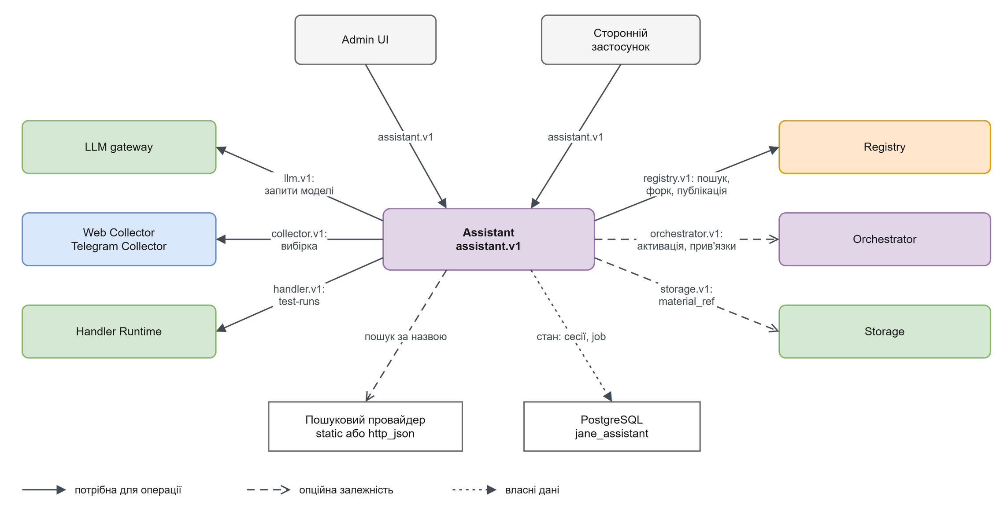

# Assistant

Assistant — HTTP-сервіс, який допомагає підключити джерело, знайти або створити екстрактор, запропонувати поліпшення пакета та класифікувати невідомий матеріал. Він керує окремими jobs і onboarding-сесіями, викликаючи сусідів через їхні контракти.

## Межі

Сам процес запускається без Orchestrator та інших сервісів і віддає health/info. Результативний onboarding потребує налаштованих LLM, відповідного колектора, Registry і Handler Runtime; прийняття пропозиції з активацією додає Orchestrator. Storage потрібний при читанні `material_ref`. Без потрібного сусіда відповідний сценарій повертає `upstream_unavailable` у job. Запуск без `state_dsn` має лише пам’ять одного процесу; для кількох екземплярів потрібна власна PostgreSQL-схема. Реальні зовнішні LLM і Telegram у цій перевірці не використовувалися.

Assistant викликає потрібних сусідів через API й зберігає власні сесії.

[Темна тема](../../diagrams/assistant/context.dark.png) · [Редаговане джерело](../../diagrams/assistant/context.drawio)
## Навігація

| Потреба | Сторінка |
|---|---|
| Запустити й отримати перший результат | [Швидкий старт](quickstart.md) |
| Вибрати потрібні сусідні сервіси | [Залежності](dependencies.md) |
| Налаштувати параметри й ліміти | [Конфігурація](configuration.md) |
| Викликати зі стороннього застосунку | [Інтеграція](integration.md) |
| Зрозуміти алгоритми й власність даних | [Будова](internals.md) |
| Відновити дані або знайти причину збою | [Експлуатація](operations.md) |
| Знайти операцію API | [API](reference/api/README.md) |
| Знайти публічний тип або член | [Типи](reference/types/README.md) |

## Джерела

[Реалізація](../../../services/assistant/src/jane_assistant/), [assistant.v1](../../../contracts/openapi/assistant.v1.yaml), [onboarding](../../../services/assistant/src/jane_assistant/onboarding.py), [improvement](../../../services/assistant/src/jane_assistant/improvement.py).
