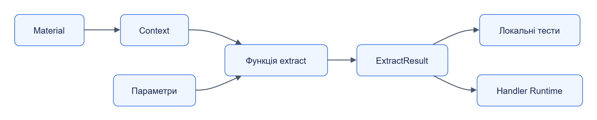

# Extractor SDK

Extractor SDK — Python-бібліотека для написання екстракторів Jane. Обробник отримує матеріал і параметри, читає вміст через `Context` та повертає сутності й діагностику.

Тип модуля: **SDK-бібліотека**. Дистрибутив: `jane-extractor-sdk`. Імпорт: `jane_extractor_sdk`. Версія: `0.1.0`.

## Навігація

| Розділ | Що знайдете |
|---|---|
| [Швидкий старт](quickstart.md) | Встановлення та мінімальний застосунок |
| [Залежності](dependencies.md) | Пакети, сумісність і заміна сусідів |
| [Налаштування](configuration.md) | Параметри, типові значення й обмеження |
| [Інтеграція](integration.md) | Використання у власному застосунку |
| [Внутрішня будова](internals.md) | Модулі, класи та рух даних |
| [Експлуатація](operations.md) | Оновлення, перевірки й діагностика |
| [Контракти](reference/api/README.md) | Межа між бібліотекою та HTTP API |
| [Публічні типи](reference/types/README.md) | Сигнатури, члени та приклади |

## Можливості

| Частина | Результат |
|---|---|
| `Context` | bytes/text, кодування, параметри, test mode |
| `entity`, `success`, `empty`, `unrecognized` | JSON-сумісний результат |
| `DiagnosticsLog` | Структуровані повідомлення з material_id |
| `testing` | Швидке локальне виконання довіреного пакета |
| `runner` | Протокол виконання між Handler Runtime та Python-кодом |
| `entities`, `compare`, `package` | Ключі сутностей, порівняння expected і читання пакета |

## Межі

SDK запускається у Python-процесі. Handler Runtime забезпечує sandbox, валідацію схем, бюджети та HTTP-виклики; Registry розповсюджує пакети. Для локального виклику SDK обидва сервіси не потрібні.

[Темна тема](../../diagrams/extractor-sdk/readme-01.dark.png) · [Редаговане джерело Draw.io](../../diagrams/extractor-sdk/readme-01.drawio)

При використанні Handler Runtime він підготовлює bytes матеріалу до запуску коду; екстрактору не потрібне завантаження blob через мережу.

## Код

[Пакет](../../../libs/extractor-sdk/pyproject.toml), [SDK](../../../libs/extractor-sdk/src/jane_extractor_sdk/), [приклад товарів](../../../libs/extractor-sdk/examples/testsite-product-extractor/).
