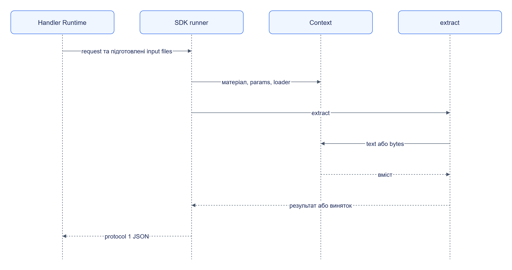

# Extractor SDK: інтеграція

## Функція пакета

```python
from jane_extractor_sdk import Context, empty, entity, success, unrecognized

def extract(material, params, ctx: Context):
    text = ctx.text()
    if not text.strip():
        return empty()
    if not text.startswith("title:"):
        return unrecognized("Невідомий формат", signature="missing-title-prefix")
    return success([entity("note", {"title": text.removeprefix("title:").strip()})])
```

Маніфест задає module/callable, input та output schemas, key_fields і tests. Дивіться [реальний пакет](../../../libs/extractor-sdk/examples/testsite-product-extractor/jane-package.json) та [довідник пакетів](../../reference/packages/README.md).

## Власний застосунок

Створіть `Context(material, params, content_loader=...)` і передайте той самий Mapping параметрів у extract. Для виконання пакета цілком використовуйте `run_local`, що читає маніфест і формує ключі та provenance.

```python
from pathlib import Path
from jane_extractor_sdk.testing import run_local

package = Path("libs/extractor-sdk/examples/testsite-product-extractor")
result = run_local(
    package,
    file=package / "tests/product-phone-alpha/page.html",
    media_type="text/html",
    url="http://testsite.local/product/phone-alpha",
)
assert result["status"] == "success"
```

## Композиція



[Темна тема](../../diagrams/extractor-sdk/integration-01.dark.png) · [Редаговане джерело Draw.io](../../diagrams/extractor-sdk/integration-01.drawio)

Runner нормалізує JSON, додає context diagnostics та перетворює винятки на error entries. Фінальний HTTP HandlerResult формує Runtime.
