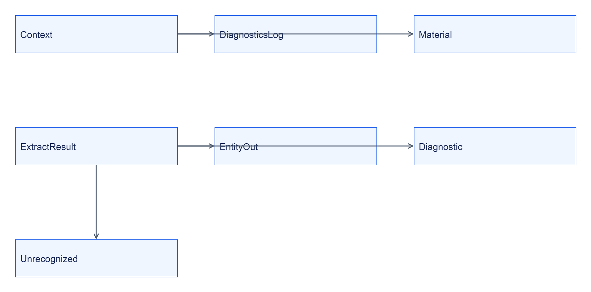
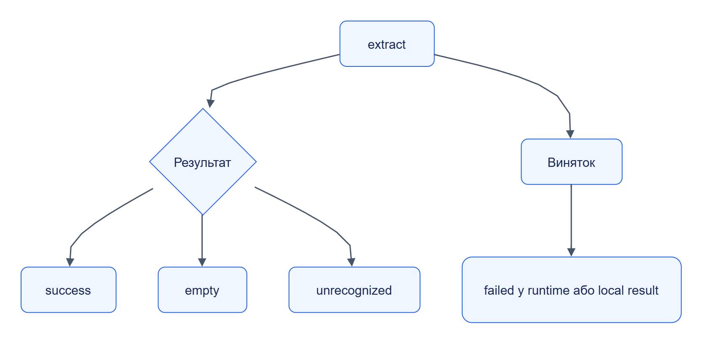

# Extractor SDK: внутрішня будова

## Структура

```text
libs/extractor-sdk/
├── src/jane_extractor_sdk/
│   ├── context.py, result.py, types.py
│   ├── runner.py, package.py, testing.py
│   └── entities.py, compare.py
├── examples/testsite-product-extractor/
└── tests/test_sdk.py
```

Експорт головних helper-функцій — [__init__.py](../../../libs/extractor-sdk/src/jane_extractor_sdk/__init__.py). Окремий executable протокол — `python -I -m jane_extractor_sdk.runner <workdir>`.

## Типи



[Темна тема](../../diagrams/extractor-sdk/internals-01.dark.png) · [Редаговане джерело Draw.io](../../diagrams/extractor-sdk/internals-01.drawio)

`Material`, `ExtractResult`, `EntityOut`, `Diagnostic` та `Unrecognized` — TypedDict; вони описують JSON-форму, а не runtime schema validation.

## Результат виклику



[Темна тема](../../diagrams/extractor-sdk/internals-02.dark.png) · [Редаговане джерело Draw.io](../../diagrams/extractor-sdk/internals-02.drawio)

`failed` не повертається helper-функцією SDK: callable піднімає виняток. `unrecognized` може містити частково отримані entities.

## Застосовність діаграм

| Вид | Застосування |
|---|---|
| Контекст, компоненти, потік | [Огляд](README.md) |
| Послідовність | [Інтеграція](integration.md) |
| Класи | Ця сторінка |
| Алгоритм і результати | Ця сторінка |
| Залежності | [Пакети та Runtime](dependencies.md) |
| ER і persistent state | SDK не має сховища; результати зберігає caller/Storage |
| Розгортання | Входить у застосунок або sandbox image Runtime |
| User flow | [Швидкий старт](quickstart.md) |
