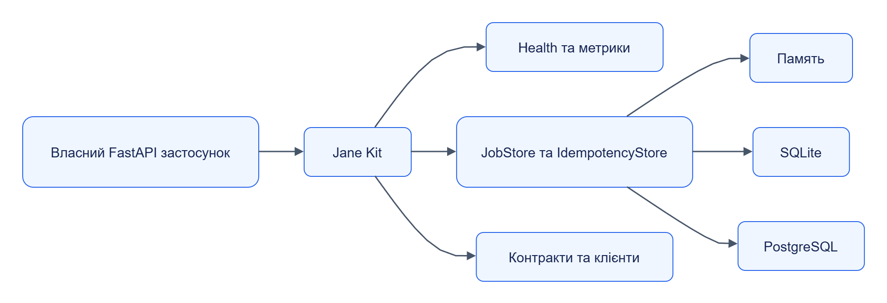

# Jane Kit

Jane Kit — Python-бібліотека спільних механізмів сервісів: конфігурації, автентифікації, помилок, журналів, метрик, job, ідемпотентності та читання контрактів. Вона дає власному застосунку однакову поведінку з сервісами Jane.

Тип модуля: **бібліотека**. Дистрибутив: `jane-kit`. Імпорт: `jane_kit`. Версія коду: `0.1.0`.

## Навігація

| Розділ | Що знайдете |
|---|---|
| [Швидкий старт](quickstart.md) | Встановлення та мінімальний застосунок |
| [Залежності](dependencies.md) | Пакети, сумісність і заміна сусідів |
| [Налаштування](configuration.md) | Параметри, типові значення й обмеження |
| [Інтеграція](integration.md) | Використання у власному застосунку |
| [Внутрішня будова](internals.md) | Модулі, класи та рух даних |
| [Експлуатація](operations.md) | Оновлення, перевірки й діагностика |
| [Контракти](reference/api/README.md) | Межа між бібліотекою та HTTP API |
| [Публічні типи](reference/types/README.md) | Сигнатури, члени та приклади |

## Що можна побудувати

| Потреба | Модуль |
|---|---|
| FastAPI-сервіс зі стандартними маршрутами | `service`, `health`, `metrics` |
| Налаштування та успадковані ліміти | `config` |
| API keys або JWT із перевіркою scopes | `auth`, `auth_scopes`, `secrets` |
| Асинхронні операції та повторна доставка | `jobs`, `idempotency`, `stores` |
| Матеріали inline/blob | `content` |
| HTTP-клієнт із повторними спробами | `clients`, `tracing` |
| Перевірка схем і генерація клієнта | `contracts`, `schemas`, `codegen` |

## Межі відповідальності

Бібліотека підключається до процесу власника: вона не запускає Orchestrator і не зберігає бізнес-дані замість Storage. Власник обирає сховище job та ідемпотентності, реєструє health checks і визначає доступ до своїх маршрутів.

[Темна тема](../../diagrams/jane-kit/readme-01.dark.png) · [Редаговане джерело Draw.io](../../diagrams/jane-kit/readme-01.drawio)

Пам’ять, SQLite та PostgreSQL — варіанти реалізації сховищ; PostgreSQL потребує додаткового пакета та доступної БД.

## Вихідний код

[Пакет і залежності](../../../libs/jane-kit/pyproject.toml), [модулі](../../../libs/jane-kit/src/jane_kit/), [тести](../../../libs/jane-kit/tests/).
