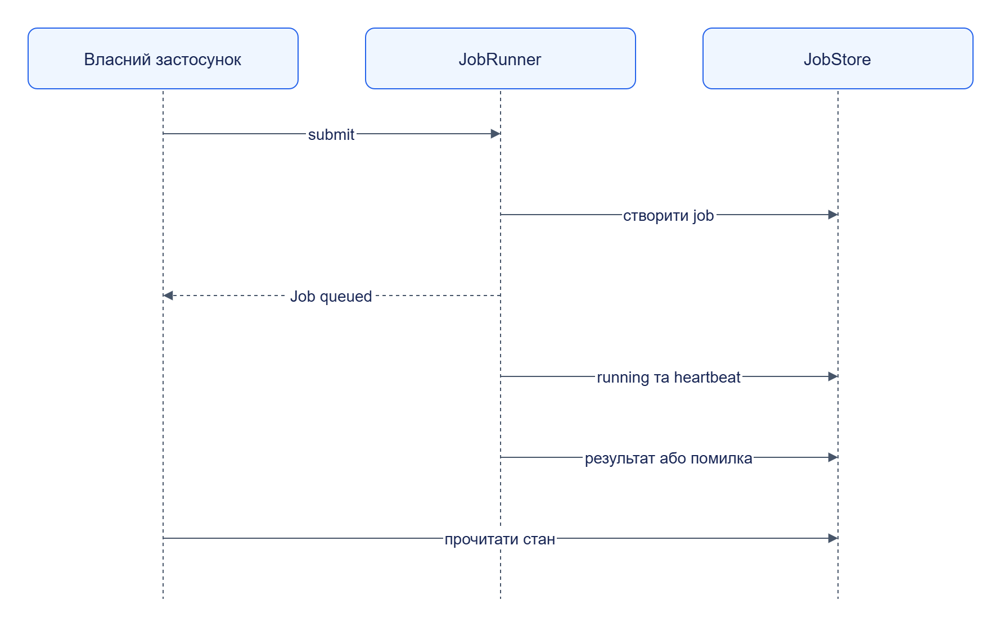

# Jane Kit: інтеграція

Підключіть потрібні механізми до власного застосунку; [мінімальний HTTP-сервіс](quickstart.md) використовує лише фабрику застосунку.

## Контент поза платформою

```python
from jane_kit.content import inline_ref

content = inline_ref(b"hello", "text/plain", text=True)
assert content["kind"] == "inline"
assert content["size_bytes"] == 5
```

`ContentRef` містить hash і розмір, однак споживач відповідає за перевірку та завантаження blob.

## Клієнт до іншого сервісу

[ServiceClient](reference/types/service-client.md) дає транспорт, tracing, тайм-аути й retry. POST із побічним ефектом повторюйте з тим самим `Idempotency-Key` і тілом. Клас HTTP-клієнта можна згенерувати з actual OpenAPI:

```powershell
uv run --package jane-kit jane-codegen client contracts/openapi/collector.v1.yaml --out .jane/generated/collector_client --no-models
```

Це генерація Python-пакета; вона не викликає Collector. Для моделей приберіть `--no-models` і встановіть datamodel-code-generator. Сигнатури результату залежать від контракту.

## Автентифікований маршрут

Для типового сервісу передайте `auth_scopes={"GET /items": "demo:read"}` у `create_app`, а settings налаштуйте для `api_key` або `jwt`. На старті перевіряється повнота таблиці: пропущений маршрут спричиняє `AuthConfigError`; брак scope у caller — 403.

## Сховища й композиція



[Темна тема](../../diagrams/jane-kit/integration-01.dark.png) · [Редаговане джерело Draw.io](../../diagrams/jane-kit/integration-01.drawio)

Схема показує бібліотечні виклики. Реалізацію сховища обирає застосунок; PostgreSQL store має власні tables, а не читає дані іншого сервісу.
