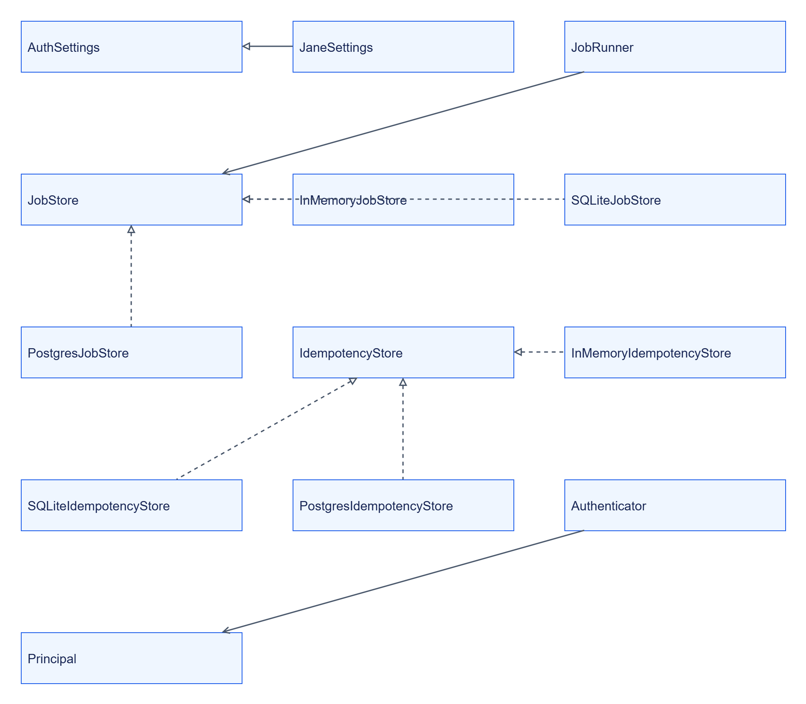

# Jane Kit: внутрішня будова

## Карта модулів

```text
libs/jane-kit/
├── src/jane_kit/
│   ├── service.py, health.py, metrics.py
│   ├── config.py, auth.py, auth_scopes.py, secrets.py
│   ├── jobs.py, idempotency.py, stores/
│   ├── clients.py, tracing.py, logs.py, errors.py
│   ├── content.py, pagination.py, contracts.py, schemas.py
│   └── rules.py, codegen.py, devstack.py
└── tests/
```

Точки входу — `create_app`, `run` і CLI `jane-codegen`.

## Типи та залежності



[Темна тема](../../diagrams/jane-kit/internals-01.dark.png) · [Редаговане джерело Draw.io](../../diagrams/jane-kit/internals-01.drawio)

Схема показує Protocol та реалізації сховищ; [сигнатури](reference/types/README.md) генеруються з коду. Не кожен сервіс використовує durable store: це рішення його власника.

## Власні дані

In-memory store живе в процесі. SQLite зберігає стан у файлі, PostgreSQL — у таблицях вибраної БД/schema. Журнали, metrics та trace context не замінюють durable business state.

## Застосовність діаграм

| Вид | Де застосований або причина |
|---|---|
| Контекст, компоненти, залежності | [Огляд](README.md); бібліотека всередині процесу |
| Послідовність і потік | [Інтеграція](integration.md); job → store |
| Класи | Ця сторінка; Protocol і implementations |
| Стани | [API](reference/api/README.md); життєвий цикл job |
| ER | Схеми конкретних [SQLite](../../../libs/jane-kit/src/jane_kit/stores/sqlite.py) та [PostgreSQL](../../../libs/jane-kit/src/jane_kit/stores/postgres.py) stores; вибір належить сервісу |
| Розгортання | Бібліотека входить у процес; окремий deployment відсутній |
| Алгоритм | [Ліміти](configuration.md#успадковані-ліміти); merge і hard caps |
| Сценарій користувача | [Швидкий старт](quickstart.md); власний сервіс |
