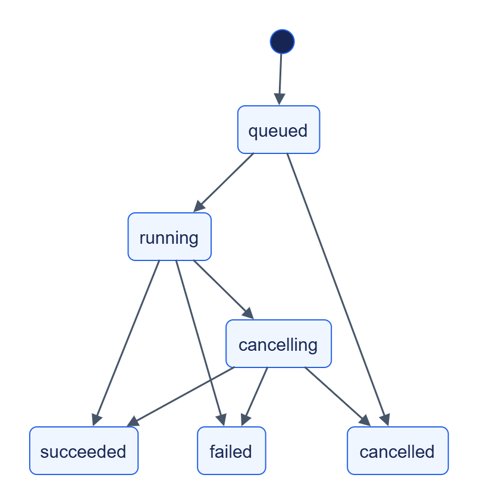

# Jane Kit: контракти

Jane Kit надає Python API та спільну HTTP-поведінку фабрики `create_app`.

## Спільні маршрути

| Маршрут | Призначення |
|---|---|
| `GET /v1/health` | Здоров’я зареєстрованих залежностей; без token |
| `GET /v1/info` | Назва, версія, capabilities, auth mode та contract-mapped limits |
| `GET /metrics` | Prometheus; видимість задає `metrics_public` |
| `GET /v1/jobs/{job_id}` | Стан job, якщо власник підключив jobs router |
| `POST /v1/jobs/{job_id}/cancel` | Запит скасування, якщо router підключений |

[common.yaml](../../../../../contracts/openapi/common.yaml) описує контракт; [довідник Python](../types/README.md) — програмне підключення. Сам `create_app` не додає jobs router.

## Job

[Темна тема](../../../../diagrams/jane-kit/reference-api-readme-01.dark.png) · [Редаговане джерело Draw.io](../../../../diagrams/jane-kit/reference-api-readme-01.drawio)

Скасування кооперативне: завершення до перевірки запиту може дати succeeded. Стани взято з [jobs.py](../../../../../libs/jane-kit/src/jane_kit/jobs.py).

## Правила помилок та повторів

Помилки використовують `application/problem+json`, рішення клієнта — за `code`. Durable claim має атомарно відрізняти зайнятий ключ, повтор відповіді та інше тіло. TTL обмежує період гарантії; власні retention і resume визначає сервіс.
