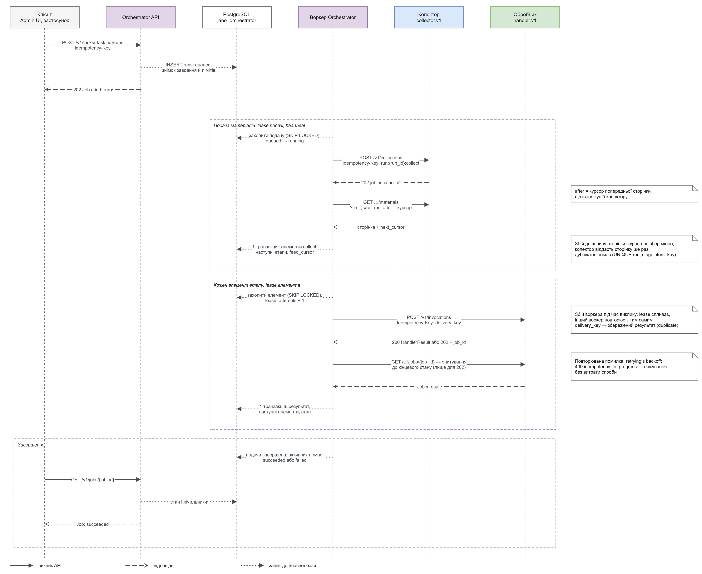

# Інтеграція Orchestrator

Клієнт створює config і запускає run через [orchestrator.v1](../../../contracts/openapi/orchestrator.v1.yaml). Успішна конфігурація не доводить доступність executor.

## Клієнт запуску

Підготовлені [source](../../../examples/documents/source.testsite-shop.json), [task](../../../examples/documents/task.testsite-catalog.json) і [connections](../../../examples/documents/connections.json) посилаються на fixture пакети та compose-адреси. Їм потрібні опубліковані версії й відповідний executor registry.

Уривок починає вже створене завдання:

```python
from uuid import uuid4
import httpx

def start_existing_task(base_url: str, token: str, task_id: str) -> dict:
    with httpx.Client(base_url=base_url, timeout=30,
                      headers={"Authorization": f"Bearer {token}"}) as client:
        response = client.post(
            f"/v1/tasks/{task_id}/runs",
            json={"reason": "External client request", "test_mode": True},
            headers={"Idempotency-Key": str(uuid4())})
        response.raise_for_status()
        return response.json()
```

Збережіть ключ для повтору POST. Відповідь — Job; його job_id одночасно є run_id. Опитуйте GET /v1/runs/{run_id} і його items. TaskConfig перевіряє POST /v1/task-validations. PUT config використовує актуальний If-Match із GET ETag.



[Темна тема](../../diagrams/orchestrator/run-sequence.dark.png) · [Draw.io](../../diagrams/orchestrator/run-sequence.drawio)

Orchestrator сам читає колектор і сам викликає handler. Логічний collect→extract не означає HTTP колектор→Runtime. При handler 202 worker опитує Job перед routing результату.

## Власний executor

Executors_file — JSON-список:

```json
[
  {
    "executor": "custom-python",
    "role": "handler",
    "base_url": "http://handler-runtime:8000",
    "token_ref": "env:CUSTOM_HANDLER_TOKEN",
    "capabilities": {
      "handler_kinds": ["extractor", "transform"],
      "default": true,
      "connections": false
    }
  }
]
```

Задайте JANE_ORCHESTRATOR_EXECUTORS_FILE та доступний token_ref; unresolved ref зупиняє старт. Заміна URL не змінює package/input/output semantics. Перевірте v1, async jobs, replay і caps перед activation.

## Reprocessing й activation

Reprocessing читає RAW через Storage, починає з обраного stage і створює новий snapshot run. Activation — явна зміна package stage із previous/kind/actor у history. Rollback повертає версію для майбутніх run, не скасовує записані сутності.

Unknown передається до LLM лише за effective прапорця та consumer stage з unmatched_materials. Сам факт наявності LLM executor не створює таку гілку.
