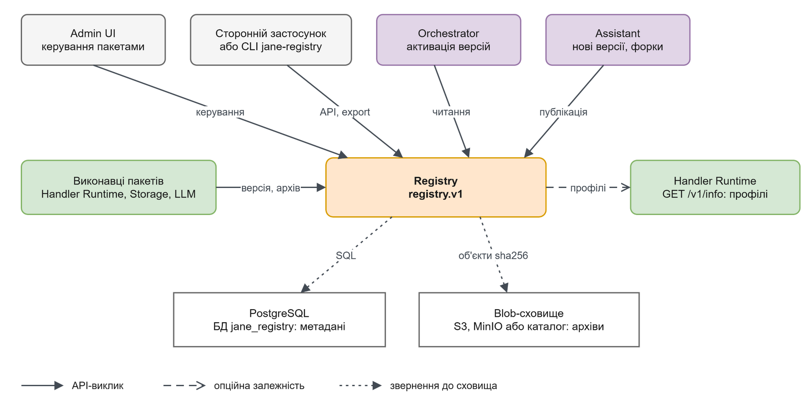

# Registry

Registry зберігає пакети обробників, незмінні версії, походження форків та звіти тестів. Сторонній клієнт може опублікувати або завантажити пакет без Orchestrator; код виконує [Handler Runtime](../handler-runtime/README.md).

## Зміст

- [Межі й результат](#межі-й-результат)
- [Контекст](#контекст)
- [Навігація](#навігація)

## Межі й результат

На вході — метадані пакета, ZIP або JSON із manifest/files та явні команди статусу, форкування і перенесення. На виході — точна версія, канонічний ZIP, digest, історія статусів та звіти. Registry перевіряє схеми, файли, залежності, ліміти й секрети, але сам не запускає тести в пісочниці.

Метадані належать власній PostgreSQL, архіви — власному S3-сумісному bucket або файловому каталогу. Режим memory придатний для одного локального процесу: метадані, job і ключі повторів зникають при перезапуску. Orchestrator, колектори, Storage та LLM не потрібні для основного API.

Опублікований номер версії не перезаписується. Форк не підхоплює батьківські зміни автоматично; перенесення — явна команда з аналізом конфліктів. Публікація та approved не означають активації в завданні.

## Контекст

[Темна тема](../../diagrams/registry/context.dark.png) · [Draw.io](../../diagrams/registry/context.drawio)

Опційне читання runtime-профілів потрібне для перевірки залежностей. Стрілка до Runtime не означає виконання пакетів Registry.

## Навігація

| Сторінка | Практичне питання |
|---|---|
| [Швидкий старт](quickstart.md) | Локальний API без повного стенда |
| [Залежності](dependencies.md) | Backend, профілі та відмови |
| [Конфігурація](configuration.md) | Параметри, env і ліміти |
| [Інтеграція](integration.md) | Публікація, експорт, сумісна заміна |
| [Будова](internals.md) | Дані, алгоритми та статуси |
| [Експлуатація](operations.md) | Backup, відновлення й моніторинг |
| [HTTP API](reference/api/README.md) | Операції та помилки |
| [Типи й члени](reference/types/README.md) | Декларації та приклади |

Джерела: [ТЗ §7](../../../TECHNICAL_SPECIFICATION.md#7-репозиторій-обробників), [код](../../../services/registry/src/jane_registry/), [OpenAPI](../../../contracts/openapi/registry.v1.yaml).
