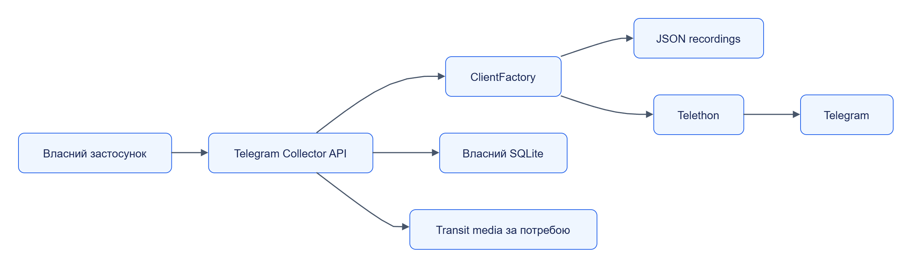

# Telegram Collector

Telegram Collector отримує історію, нові повідомлення та редагування каналів і видає їх як `Material` через pull API. Backend можна обрати для реального Telegram або автономного відтворення JSON recordings.

Тип модуля: **колектор-сервіс**. Пакет: `jane-telegram-collector`. Імпорт: `jane_telegram_collector`. Версія: `0.1.0`. Типовий порт: `8102`.

## Навігація

| Розділ | Зміст |
|---|---|
| [Швидкий старт](quickstart.md) | Локальний автономний запуск і перший матеріал |
| [Залежності](dependencies.md) | Мінімум, опційні інтеграції та заміна |
| [Налаштування](configuration.md) | Environment, defaults, ліміти й секрети |
| [Інтеграція](integration.md) | Pull-потік, курсор, сторонній клієнт |
| [Будова](internals.md) | Компоненти, власний стан, класи та ER |
| [Експлуатація](operations.md) | Відновлення, health, retention і діагностика |
| [HTTP API](reference/api/README.md) | Операції, гарантії й помилки |
| [Типи](reference/types/README.md) | Усі публічні класи та члени |

## Можливості

| Сценарій | Механізм |
|---|---|
| Одне повідомлення | `POST /v1/fetches` |
| Історія каналів | history.enabled, since та max_messages |
| Нові/редаговані повідомлення | updates, channel cursor і revision dedup |
| Медіа | Опційне завантаження з max_media_bytes |
| Продовження | Власний SQLite, lease, channel cursors |
| FloodWait | Очікування у визначеній межі, далі rate_limited |
| Автономний replay | RecordedClientFactory без Telegram account |

## Контур

[Темна тема](../../diagrams/telegram-collector/readme-01.dark.png) · [Редаговане джерело Draw.io](../../diagrams/telegram-collector/readme-01.drawio)

Типовий client_backend — recorded. Реальний доступ потребує telethon extra й авторизованої session; Collector не виконує interactive login.

## Код

[Settings](../../../services/telegram-collector/src/jane_telegram_collector/settings.py), [API](../../../services/telegram-collector/src/jane_telegram_collector/app.py), [Protocol клієнта](../../../services/telegram-collector/src/jane_telegram_collector/client.py).
