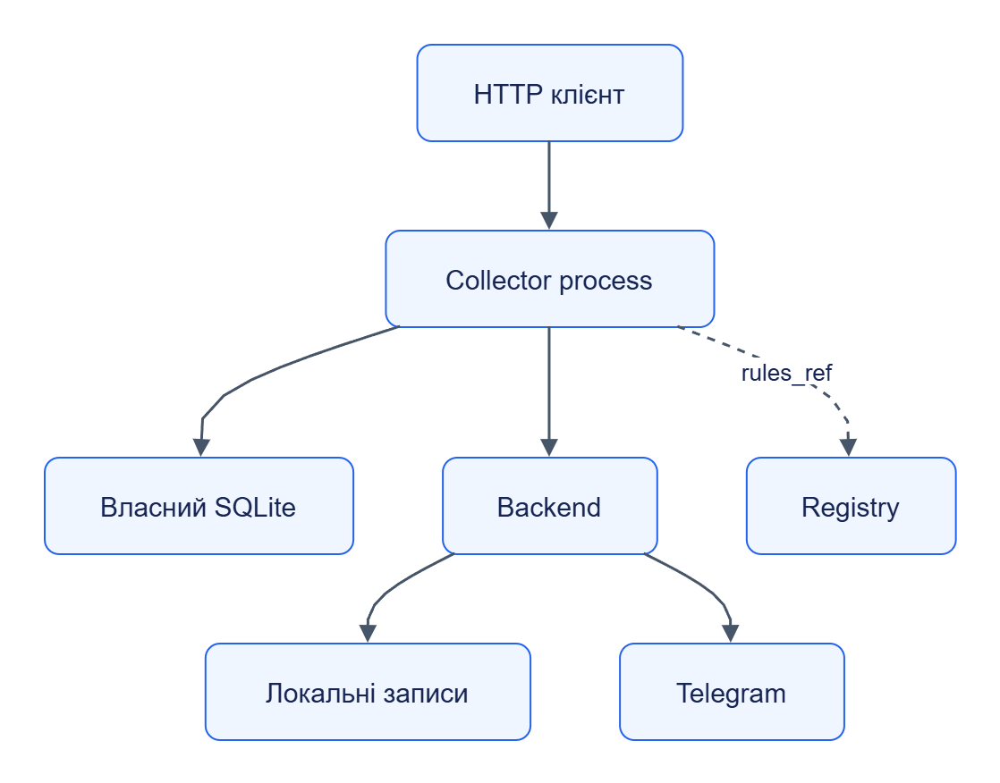

# Telegram Collector: залежності

## Мінімум

Python `>=3.12`, jane-kit, httpx, jsonschema; writable state_dir та доступні collector schemas. Версії — [pyproject.toml](../../../services/telegram-collector/pyproject.toml), [lockfile](../../../uv.lock).

## Backends

| Backend | Залежність | Поведінка |
|---|---|---|
| `recorded` | recordings_dir із `<username або channel_id>.json` | Без account; відсутній запис → ChannelUnavailable |
| `telethon` | Extra telethon `>=1.36,<2`; авторизований account | Без account/session → account error |
| `module:factory` | Власна ClientFactory | Має реалізувати TelegramClient Protocol |

Recorded replay не підтверджує Telegram credentials, access rights або роботу реальних media downloads.

## Інші залежності

Registry опційний для rules_ref; локальний rules_dir перевіряється раніше. Inline rules працюють автономно. Transit directory потрібен для великих content/media. Orchestrator, Storage та Handler Runtime не потрібні для збору.

[Темна тема](../../diagrams/telegram-collector/dependencies-01.dark.png) · [Редаговане джерело Draw.io](../../diagrams/telegram-collector/dependencies-01.drawio)

## Заміна

ClientFactory.open повертає TelegramClient із resolve, history, get_message, changes, download_media, close. History/changes повинні зберігати семантику cursor/pts та FloodWait. [Контракт Python](../../../services/telegram-collector/src/jane_telegram_collector/client.py) описує типи й сигнатури.
