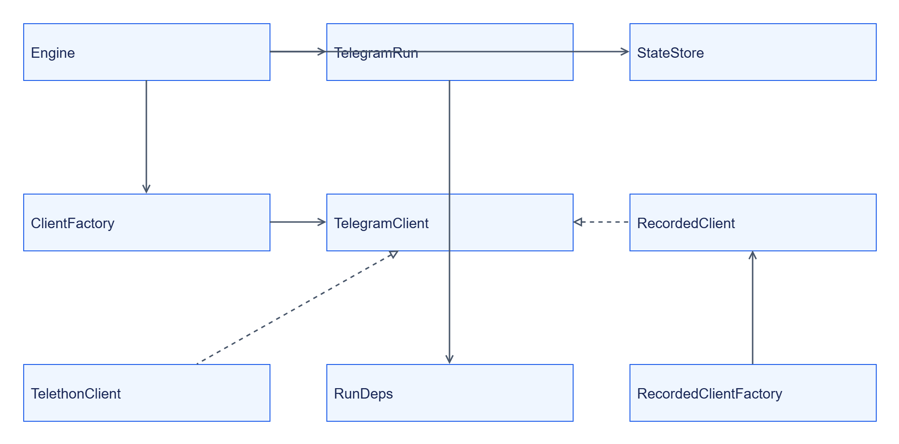
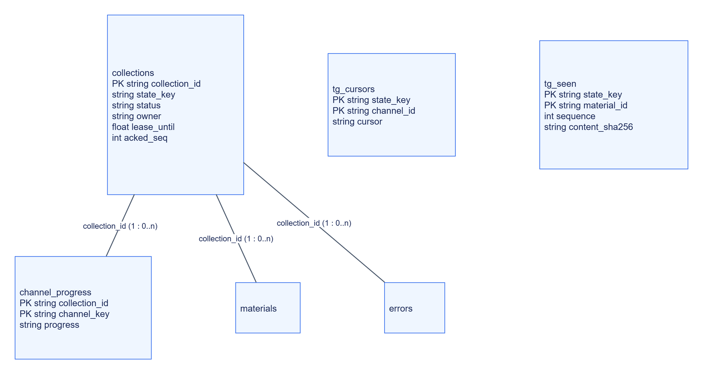

# Telegram Collector: внутрішня будова

## Структура

```text
services/telegram-collector/
├── src/jane_telegram_collector/
│   ├── __main__.py, app.py, settings.py
│   ├── engine.py, collector.py, rules.py
│   ├── client.py, recorded.py, telethon_client.py
│   ├── state.py, stores.py, connections.py, materials.py
│   └── testing.py
└── tests/
```

Engine запускає TelegramRun, що читає history/changes та формує Material. Точка входу — CLI `jane-telegram-collector`.

## Класи



[Темна тема](../../diagrams/telegram-collector/internals-01.dark.png) · [Редаговане джерело Draw.io](../../diagrams/telegram-collector/internals-01.drawio)

Protocol дозволяє власну реалізацію backend. Матеріали й client errors описані [типами](reference/types/README.md).

## ER власного стану



[Темна тема](../../diagrams/telegram-collector/internals-02.dark.png) · [Редаговане джерело Draw.io](../../diagrams/telegram-collector/internals-02.drawio)

Зв’язки логічні; DDL не задає foreign keys. Окремо зберігаються connections, jobs, idempotency та counters. `tg_seen` дедуплікує незмінену revision; edits створюють нову observation.

## Алгоритм збору

Resolve channel → history after_id → changes за pts → revision/hash dedup → Material/media → buffer. Занадто старий pts (`too_long`) потребує catch-up history. Cursor зберігається за state_key і використовується наступним incremental збором.

## Застосовність діаграм

| Вид | Розміщення |
|---|---|
| Контекст, компоненти, data flow | [Огляд](README.md) |
| Залежності й deployment | [Залежності](dependencies.md) |
| Класи, ER та алгоритм | Ця сторінка |
| Послідовність | [Інтеграція](integration.md) |
| Стани | [Експлуатація](operations.md#життєвий-цикл) |
| User flow | [Recorded replay](quickstart.md) |
