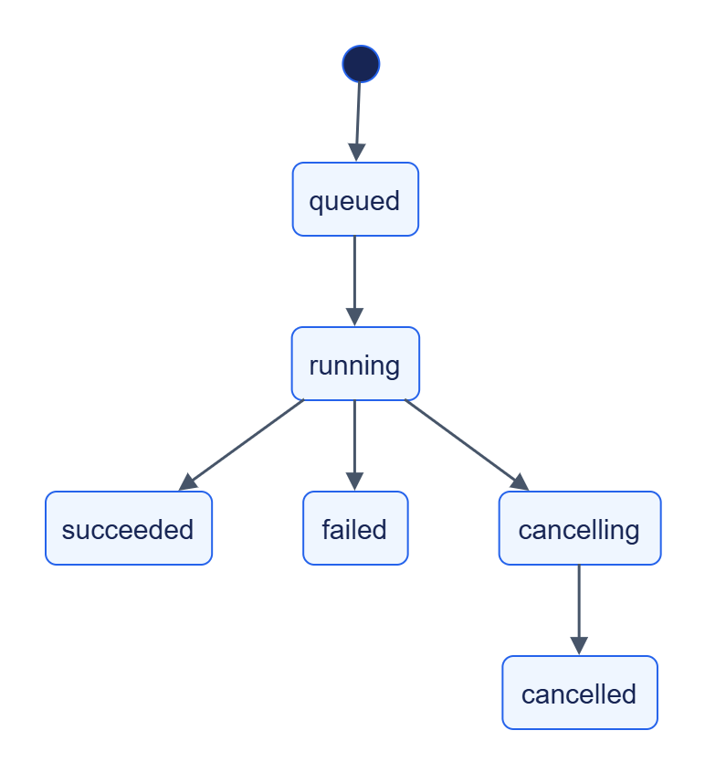

# Telegram Collector: експлуатація

## Життєвий цикл



[Темна тема](../../diagrams/telegram-collector/operations-01.dark.png) · [Редаговане джерело Draw.io](../../diagrams/telegram-collector/operations-01.drawio)

Backpressure позначений окремим `paused_by_backpressure`; це не новий статус job. Скасування кооперативне: job може завершитись раніше, ніж обробить запит.

## Резервування та відновлення

Зупиніть усі instances із цим state_dir або зробіть consistent SQLite backup. Зберігайте state.db разом із потрібними transit blobs, локальними rules та operator configuration. WAL/SHM не можна копіювати довільно під час запису.

Після restart сервіс перечитує активні збори; новий owner підхоплює їх після lease timeout. Instance ID включає новий UUID. Втрата state.db означає втрату frontier/cursors, job, ключів ідемпотентності та керованих connections. Незавершені збори можуть повторно видати матеріали; downstream має підтверджувати лише надійно оброблене.

Схема SQLite створюється самим StateStore, додаткові службові колонки додає реалізація. Перед оновленням зробіть backup та перевірте відновлення на копії; окремої версіонованої CLI-міграції колектора немає.

## Retention

`jobs.job_retention_seconds=86400`: колекція стає простроченою, звернення до неї дає 410 `not_found`. Transit TTL — 604800 с, GC interval — 3600 с. Не видаляйте активні state keys: DELETE зайнятого стану повертає conflict.

## Перевірка

`GET /v1/health` відкритий; `GET /v1/info` показує capabilities й contract-mapped limits; `/metrics` залежить від спільних settings. Журнали JSON містять trace_id/request_id. Передавайте traceparent між своїми клієнтами.


## Діагностика

| Ознака | Перевірка |
|---|---|
| recorded: recordings_dir is not set | Directory налаштований та існує |
| channel_unavailable | Доступ до каналу, username/channel_id, JSON recording |
| account_unauthorized | Авторизована session, api_id/api_hash, secret refs |
| rate_limited | FloodWait перевищує max_flood_wait_seconds |
| Нові матеріали не з’являються | Cursors, tg_seen, unchanged revisions, history/update flags |
| Медіа немає | media.download, kind filter, max_media_bytes та transit |
| paused_by_backpressure | Клієнт підтверджує after лише після обробки |
| Помилка stale lease | Heartbeat, busy timeout, writable state і кількість instances |

## Зовнішні секрети

Session створюйте й авторизуйте поза Collector. Зберігайте її в env/file secret storage; зміна environment застосовується на restart. Перевіряйте connection через test operation без розкриття session.

## Перевірка коду

```powershell
uv run --package jane-telegram-collector pytest services/telegram-collector/tests/test_collect.py services/telegram-collector/tests/test_processes.py
```

Recorded tests перевіряють логіку власного компонента; реальний Telegram потребує окремого доступу.
