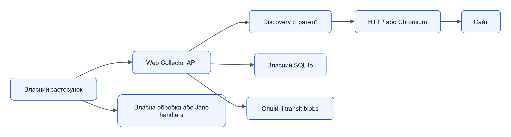

# Web Collector

Web Collector збирає матеріали із сайтів: знаходить URL за правилами, завантажує сторінки та видає потік `Material`. Власний застосунок може викликати його без Orchestrator.

Тип модуля: **колектор-сервіс**. Пакет: `jane-web-collector`. Python module: `jane_web_collector`. Версія: `0.1.0`. Типовий порт: `8101`.

## Навігація

| Розділ | Зміст |
|---|---|
| [Швидкий старт](quickstart.md) | Локальний автономний запуск і перший матеріал |
| [Залежності](dependencies.md) | Мінімум, опційні інтеграції та заміна |
| [Налаштування](configuration.md) | Environment, defaults, ліміти й секрети |
| [Інтеграція](integration.md) | Pull-потік, курсор, сторонній клієнт |
| [Будова](internals.md) | Компоненти, власний стан, класи та ER |
| [Експлуатація](operations.md) | Відновлення, health, retention і діагностика |
| [HTTP API](reference/api/README.md) | Операції, гарантії й помилки |
| [Типи](reference/types/README.md) | Усі публічні класи та члени |

## Можливості

| Потреба | Механізм |
|---|---|
| Одна сторінка | `POST /v1/fetches` |
| Список URL або обхід | `POST /v1/collections` |
| Пошук URL | seed_list, recursive, sitemap, feed, listing, url_template, api_feed |
| Зміни джерела | incremental, ETag/Last-Modified, revisit та lastmod |
| JS-сторінки | Опційний headless Chromium |
| Контроль навантаження | robots, rate, per-host concurrency, retries та backpressure |
| Продовження після збою | Власний SQLite стан, lease та fencing |

`auto_detect` зарезервований у схемі та не виконується цим Collector; [Assistant](../assistant/README.md) може запропонувати звичайні правила.

## Автономний контур

[Темна тема](../../diagrams/web-collector/readme-01.dark.png) · [Редаговане джерело Draw.io](../../diagrams/web-collector/readme-01.drawio)

Колектор накопичує матеріали; клієнт читає й підтверджує їх курсором. Виклики Handler Runtime або Storage робить клієнт чи Orchestrator.

## Код

[Settings](../../../services/web-collector/src/jane_web_collector/settings.py), [API](../../../services/web-collector/src/jane_web_collector/app.py), [тести](../../../services/web-collector/tests/).
