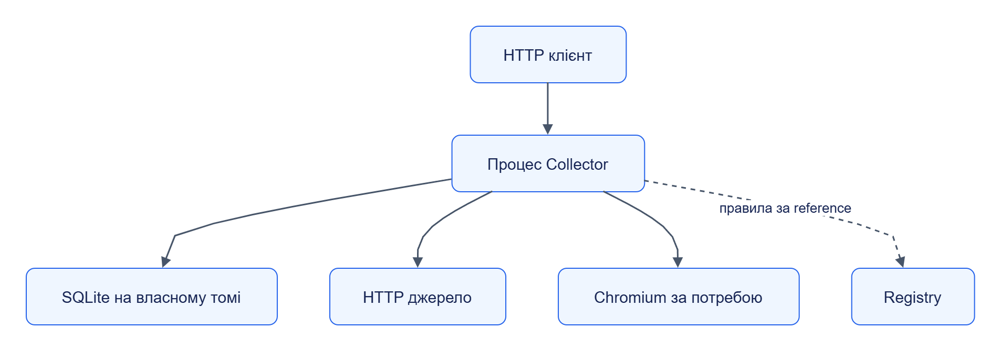

# Web Collector: залежності

## Мінімальне середовище

Python `>=3.12`, jane-kit, jane-contracts, httpx, lxml, cssselect; writable state_dir; доступ до HTTP(S) джерела. Схеми collector API мають бути доступні у checkout або через contracts_dir. Версії — [pyproject.toml](../../../services/web-collector/pyproject.toml) та [uv.lock](../../../uv.lock).

## Опційні інтеграції

| Залежність | Коли потрібна | За недоступності |
|---|---|---|
| Registry | `rules_ref` поза локальним rules_dir | Завантаження правил не відбудеться |
| Локальні rules packages | Автономний rules_ref | Правила шукаються локально перед Registry |
| Playwright + Chromium | `fetch.render_js=true` | `not_implemented`, без fallback до plain fetch |
| Transit directory | Матеріали понад inline limit або `content_delivery=blob` | Примусовий blob відхиляється; великий inline обмежений |
| API-key/JWT issuer | Автентифікований віддалений сервіс | Неповна конфігурація не дозволяє старт |
| Discovery package | Sitemap/feed/listing/template/API feed | Непідтримана стратегія відхиляється |

Discovery path типово вказує на `services/web-collector/strategies/discovery`. У standalone wheel треба надати цей directory окремо або використовувати вбудовані seed_list/recursive.

## Розгортання та заміна

[Темна тема](../../diagrams/web-collector/dependencies-01.dark.png) · [Редаговане джерело Draw.io](../../diagrams/web-collector/dependencies-01.drawio)

Inline rules усувають залежність від Registry. Discovery strategy можна замінити реалізацією [Protocol](../../../contracts/python/src/jane_contracts/discovery.py) з snapshot/restore. Orchestrator не є залежністю Collector.
