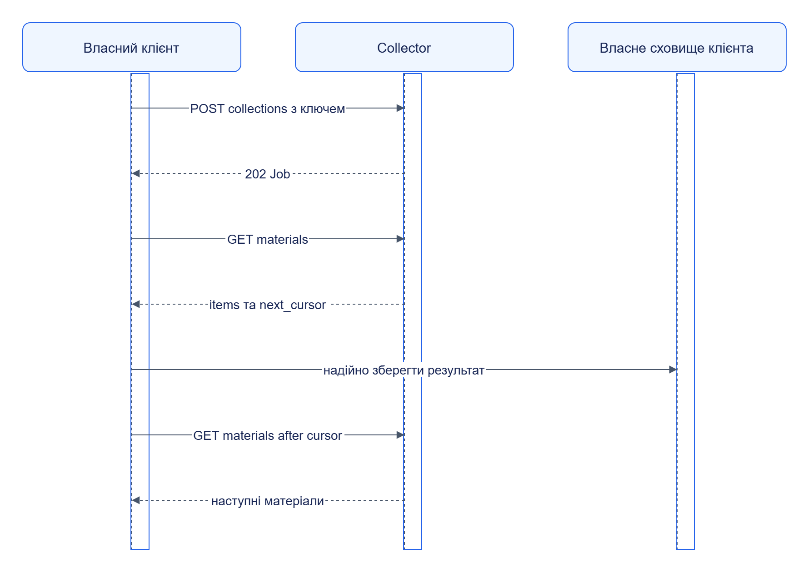

# Web Collector: інтеграція

Collector підтримує спільний [collector.v1](../../../contracts/openapi/collector.v1.yaml). Правила визначають scope, discovery, robots, fetch і limits.

## Мінімальний клієнт

Після [локального запуску](quickstart.md) збережіть наступний Python-код як `demo_collect.py` у корені. Поточна реалізація використовує `job_id` також як collection_id.

```python
import json
import time
import uuid
from pathlib import Path
import httpx

base = "http://127.0.0.1:8192"
rules = {
    "collector": "web",
    "scope": {"allowed_domains": ["127.0.0.1"]},
    "strategies": [
        {"type": "seed_list", "urls": ["http://127.0.0.1:8191/index.html"]}
    ],
}
body = {
    "source_kind": "web",
    "source_id": "docs-web",
    "mode": "full",
    "rules": rules,
}
with httpx.Client(base_url=base, timeout=35) as client:
    response = client.post(
        "/v1/collections",
        json=body,
        headers={"Idempotency-Key": "docs-" + uuid.uuid4().hex},
    )
    response.raise_for_status()
    collection_id = response.json()["job_id"]
    cursor = None
    count = 0
    for _ in range(60):
        params = {"wait_ms": 1000}
        if cursor is not None:
            params["after"] = cursor
        response = client.get(
            f"/v1/collections/{collection_id}/materials", params=params
        )
        response.raise_for_status()
        page = response.json()
        for material in page["items"]:
            output = Path(".jane/docs-web/received")
            output.mkdir(parents=True, exist_ok=True)
            (output / (material["observation_id"] + ".json")).write_text(
                json.dumps(material, ensure_ascii=False), encoding="utf-8"
            )
            count += 1
        cursor = page["next_cursor"]
        if page["end_of_stream"]:
            if cursor is not None:
                ack = client.get(
                    f"/v1/collections/{collection_id}/materials",
                    params={"after": cursor},
                )
                ack.raise_for_status()
            assert page["collection_status"] == "succeeded", page
            break
        time.sleep(0.1)
    else:
        raise TimeoutError("Колекція не завершилась")
    print(f"Збережено матеріалів: {count}")
```

```powershell
uv run --package jane-web-collector python demo_collect.py
```

Очікуйте щонайменше один запис у received. Для відновлюваного клієнта persist курсор разом із результатом обробки; приклад тримає його в пам’яті та повтор після власного збою може перечитати матеріал.

## Pull і підтвердження



[Темна тема](../../diagrams/web-collector/integration-01.dark.png) · [Редаговане джерело Draw.io](../../diagrams/web-collector/integration-01.drawio)

`after` підтверджує всі видані матеріали до цього курсора. Передчасне підтвердження втрачає можливість повторного читання. Якщо клієнт перестає читати, unacked buffer досягає limit і producer призупиняється.

## Композиція й заміна

У Jane цю роль виконує [Orchestrator](../orchestrator/README.md): він читає Material, викликає handlers і підтверджує успішну доставку. Власний клієнт може замінити його тим самим API. Для blob споживач мусить мати доступ до URI та перевірити hash; локальний file URI потребує спільного mounted path.

Для захищеного сервісу додайте bearer header із потрібними [scopes](reference/api/README.md). Inline rules замінюють Registry-залежність, зберігаючи форму контракту.
