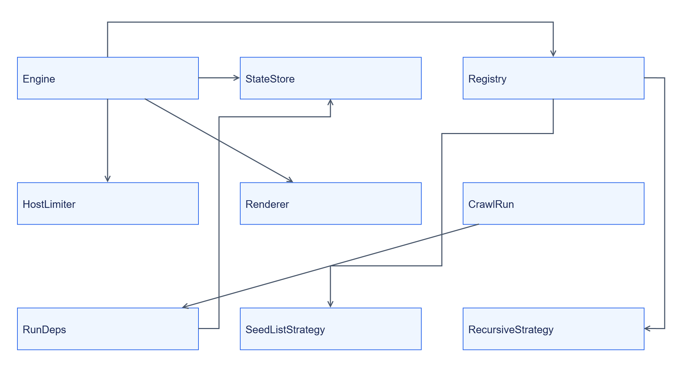
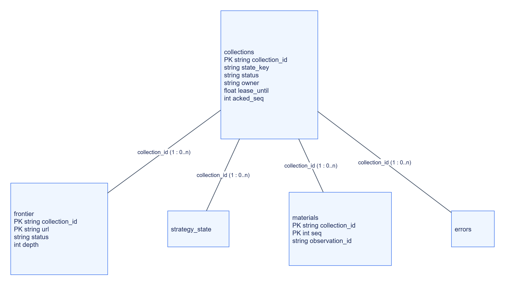

# Web Collector: внутрішня будова

## Каталоги та точки входу

```text
services/web-collector/
├── src/jane_web_collector/
│   ├── __main__.py, app.py, settings.py
│   ├── engine.py, crawler.py, fetcher.py
│   ├── discovery/, rules.py, urls.py, robots.py
│   ├── host_limits.py, shared_hosts.py, egress.py, render.py
│   ├── state.py, stores.py, materials.py, connections.py
│   └── testing.py
├── strategies/discovery/
└── tests/
```

CLI будує Settings → build_app → Uvicorn. Engine координує lifecycle; CrawlRun виконує окремий збір; Fetcher завантажує ресурс.

## Класи



[Темна тема](../../diagrams/web-collector/internals-01.dark.png) · [Редаговане джерело Draw.io](../../diagrams/web-collector/internals-01.drawio)

Зовнішні discovery implementations підключаються через Registry і Protocol. Сигнатури — [у довіднику](reference/types/README.md).

## Власні дані



[Темна тема](../../diagrams/web-collector/internals-02.dark.png) · [Редаговане джерело Draw.io](../../diagrams/web-collector/internals-02.drawio)

ER показує логічні зв’язки, а не SQL foreign keys. Окремо є url_state/state_cursors за state_key, connections, jobs, idempotency, counters та host_users/schedule/slots/waiters. [DDL](../../../services/web-collector/src/jane_web_collector/state.py) зберігає цілісність через транзакції та ownership fencing.

## Обхід

Discovery → scope/normalization/robots → dedup/frontier → host limiter → fetch/render → Material → unacked buffer. HTTP conditional requests використовують ETag/Last-Modified; незмінений 304 не створює новий матеріал. Стратегія не обходить core limits.

## Застосовність діаграм

| Вид | Розміщення |
|---|---|
| Контекст, компоненти, потік | [Огляд](README.md) |
| Розгортання та залежності | [Залежності](dependencies.md) |
| Класи, ER, алгоритм обходу | Ця сторінка |
| Послідовність | [Інтеграція](integration.md) |
| Стани | [Експлуатація](operations.md#життєвий-цикл) |
| User flow | [Швидкий старт](quickstart.md); джерело → матеріал |
