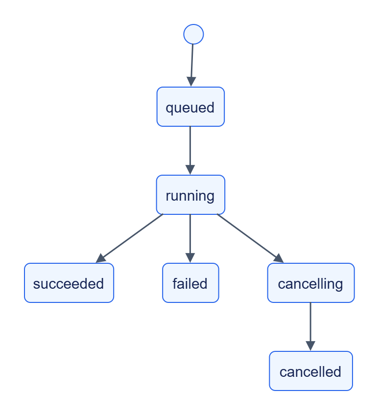

# Web Collector: експлуатація

## Життєвий цикл



[Темна тема](../../diagrams/web-collector/operations-01.dark.png) · [Редаговане джерело Draw.io](../../diagrams/web-collector/operations-01.drawio)

Backpressure позначений окремим `paused_by_backpressure`; це не новий статус job. Скасування кооперативне: job може завершитись раніше, ніж обробить запит.

## Резервування та відновлення

Зупиніть усі instances із цим state_dir або зробіть consistent SQLite backup. Зберігайте state.db разом із потрібними transit blobs, локальними rules та operator configuration. WAL/SHM не можна копіювати довільно під час запису.

Після restart сервіс перечитує активні збори; новий owner підхоплює їх після lease timeout. Instance ID включає новий UUID. Втрата state.db означає втрату frontier/cursors, job, ключів ідемпотентності та керованих connections. Незавершені збори можуть повторно видати матеріали; downstream має підтверджувати лише надійно оброблене.

Схема SQLite створюється самим StateStore, додаткові службові колонки додає реалізація. Перед оновленням зробіть backup та перевірте відновлення на копії; окремої версіонованої CLI-міграції колектора немає.

## Retention

`jobs.job_retention_seconds=86400`: колекція стає простроченою, звернення до неї дає 410 `not_found`. Transit TTL — 604800 с, GC interval — 3600 с. Не видаляйте активні state keys: DELETE зайнятого стану повертає conflict.

## Перевірка

`GET /v1/health` відкритий; `GET /v1/info` показує capabilities й contract-mapped limits; `/metrics` залежить від спільних settings. Журнали JSON містять trace_id/request_id. Передавайте traceparent між своїми клієнтами.


## Діагностика

| Ознака | Перевірка |
|---|---|
| Збір paused | Чи клієнт підтверджує after cursor; unacked limit |
| Немає матеріалів | scope/robots, 304, dedup, incremental revisit, collection errors |
| 422 на rules | valid/supported report; auto_detect не підтримується |
| 422 для credentials | Env/file reference та точний origin allowlist |
| `not_implemented` render | render_enabled, Playwright та Chromium |
| `render_incomplete`/`render_budget_exceeded` | Browser timeout/transfer limits; DOM може бути неповним |
| `rate_limited` | Retry-After або Crawl-delay перевищує cap |
| SQLite busy/lease failure | Busy timeout, heartbeat constraint, writers і shared-host TTL |
| Egress denied | DNS, link-local/private policy та redirects |

## Перевірка коду

```powershell
uv run --package jane-web-collector pytest services/web-collector/tests/test_autonomy.py services/web-collector/tests/test_resume_after_kill.py
```

Для browser rendering окремо потрібен Chromium; зовнішні сайти перевіряються окремими сценаріями доступу.
