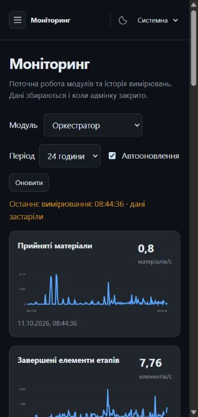

# WP-33 — моніторинг і керування модулями

Стан: **review**. Гілка: `wp/33-admin-operations-integrated`.
База інтеграції: `1406aa2cbbb27485874c6c6fd66a109a4ba2fb9b` (`origin/main`, 11.10.2026).

## Результат

В адмінці додано розділи **Моніторинг** і **Модулі**. Кожен із восьми модулів має власні вкладки стану, графіків, налаштувань і діагностики та переходи до пов’язаних дій. Огляд показує роботу черги й обробки. Основні параметри видимі першими; розширені доступні перемикачем і пошуком. Платформні типові ліміти та жорсткі межі редагуються формою; JSON залишено як розширений режим.

Графіки використовують вимірювання сервісів: швидкість API та обробки, 5xx, середній час запиту, чергу, активні елементи та вік черги. Є періоди 15 хв/1 год/6 год/24 год, автооновлення й пауза. Невідомі значення показуються як недоступні; відсутність запитів не перетворюється на фальшиву нульову затримку. Процеси й пропуски розривають графік, а проріджена історія враховує власну роздільність.

Конфігурація й історія зберігаються кожним модулем у власному SQLite та окремому томі. Налаштування застосовуються після перезапуску; форма відрізняє активне, успадковане й збережене значення. PUT вимагає ETag, перевіряє типи та жорсткі межі, журналює актора. Секрети й політики доступу не редагуються цією формою.

## Межі та контракти

Додано спільний `operations.v1.yaml`, дві схеми й згенерований клієнт. Реалізація — `jane-kit`; споживачі — усі вісім сервісів через `create_app` та адмінка. Оркестратор читає лише власні `items`; інші БД не використовуються. Scopes: `modules:read`/`modules:write`.

Під час rebase збережено нові реалізації, тести, документацію та приклади POST-пагінації колектора з main. `fetch.transport`, знайдений у координованому кандидаті, вилучено після зауваження contract-guardian: інтегрований main ще не реалізує його. CollectorRules відповідає main; наявні сім API не змінюються.

Цей етап не додає кластерної агрегації метрик чи дистанційного перезапуску. Історія належить окремому процесу/модулю. Доступність зовнішніх сайтів і LLM не є критерієм цього WP.

## Перевірки

Фактичний вивід цільових перевірок:

```text
pytest libs/jane-kit/tests/test_operations.py -q
........                                                                 [100%]
8 passed in 2.47s

vitest run src/components/module-operations.test.tsx src/config.test.ts
Test Files  2 passed (2)
Tests       9 passed (9)

tsc -p tsconfig.json
exit 0

vite build
178 modules transformed
built in 1.13s

python .codex/hooks/jane_wp.py check-diff origin/main
WP-33: 43 changed file(s), 0 outside ownership
```

Повний `uv run --no-project python scripts/dev.py check` після rebase запущено; фінальний вивід буде додано після завершення. Так само фінальний contract-guardian і незалежний wp-reviewer завершують перевірку інтегрованого head.

## Реальна адмінка

Стек `jane-demo`, адреса `http://127.0.0.1:54347`. Оновлено живу адмінку та operations-шар сервісів із фактичних поточних образів. Збережено env, порти, томи, sandbox supplementary group, активні завдання та чужі розгортання. Helper відмовляє, якщо образ змінився після підготовки; маніфести із секретами залишаються лише в ігнорованій `.jane/`.

Ручна перевірка через браузер: Assistant `operations_max_points` змінено 720 → 721, збережено формою, перезапущено лише Assistant; параметр став активним, історія залишилася. Через «Успадкувати» повернуто 720 та повторно перезапущено; тестове перевизначення прибрано.

```json
{"before_samples":143,"after_samples":144,"active_max_points":721,"pending_restart":false}
{"before_samples":177,"after_samples":178,"active_max_points":720,"pending_restart":false}
```

Перший real Playwright запуск: усі вісім сторінок/форм/діагностики/графіків пройшли; перевірка періодів, паузи та екрана 390×844 пройшла. Сценарій збереження потрапив у перезапуск Assistant під час розгортання, тому повторюється після завершення rollout. Тести не послаблювалися.



## Виправлення після рев’ю

Contract-guardian: виправлено reset до baseline, обов’язкові route scopes, UTC `Z`, документацію споживачів, опис PUT і optional resolution; вилучено непідтримуваний `fetch.transport`. Остаточний вердикт буде додано тут.

## Запити до інших власників

Немає незакритих потреб у контрактах для цього етапу. Статус доставки веде координатор; main не змінювався цим WP.
