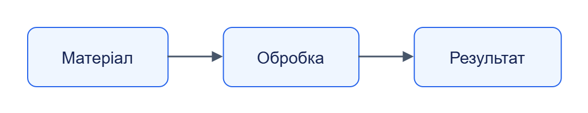

# Стиль документації

Еталон — [кореневий README](../../README.md). Агенти застосовують [jane-documentation](../../.agents/skills/jane-documentation/SKILL.md).

## Сторінка

Один заголовок першого рівня; коротке призначення, потім послідовні розділи другого й третього рівня. Для довгої сторінки — зміст зі звичайними посиланнями на заголовки. Чистий Markdown, без HTML-якорів або HTML у діаграмах. Таблиці мають короткі рядки й однозначні назви.

## Приклади

Команди — `powershell`, специфічні Bash-команди — `bash`, код і дані — відповідна мова (`python`, `typescript`, `json`, `yaml`, `sql`). Дерева й буквальний вивід — `text`. Кожен блок має мову; команда й її результат — різні блоки. Позначай передумови, робочу директорію, очікуваний результат та наслідки очищення.

## Діаграми

Для кожного питання обирай доречну схему Draw.io. Усі редаговані джерела й прозорі PNG для обох тем зберігаються в `docs/diagrams/`. Пояснюй стрілки, відрізняй потік даних від HTTP-викликів. Колір доповнює підписи. Перевіряй синтаксис і фактичний рендер окремо.

## Факти та версія

Основою є код, контракти, конфігурація та актуальні запуски. Звіт містить базову ревізію, інструмент, результат і межі перевірки. Невиконана перевірка не є успішною. Не дублюй спільні пояснення; посилайся на довідники.

## Сталі адреси, терміни й редагування

Імена каталогів — англійською kebab-case; назви модулів збігаються з кодом. Відносні посилання використовують `/`. Для назв розділів використовуй однозначні українські заголовки й автоматичні якорі; після перейменування онови callers. Загальні терміни: матеріал (RAW і метадані), сутність (структуровані поля), пакет (версіонована логіка), завдання (процес), job (асинхронна операція).

Генеровані сторінки зберігаються лише в `reference/types/generated/` та `reference/api/generated/`; їх змінює генератор. Авторські пояснення й приклади залишаються поза цими каталогами. У звіті вкажи SHA базового коду, команду генерації та інструмент рендеру.

## Приклад оформлення

- [Сталі адреси](#сталі-адреси-терміни-й-редагування)
- [Приклад оформлення](#приклад-оформлення)

| Роль | Результат |
|---|---|
| Колектор | Матеріал із метаданими |
| Екстрактор | Структуровані сутності |

Команда перевірки модуля:

```powershell
just test web-collector
```

Ключові поля підсумку демонстраційного сценарію:

```json
{
  "ok": true,
  "failures": []
}
```

Логічний потік даних; стрілки не позначають прямі HTTP-виклики:



[Темна тема](../diagrams/development/documentation-style-01.dark.png) · [Редаговане джерело Draw.io](../diagrams/development/documentation-style-01.drawio)


## Відтворення візуальної перевірки

Для кожної діаграми обов’язкові три файли в `docs/diagrams/<розділ>/`: `<назва>.drawio`, `<назва>.light.png`, `<назва>.dark.png`. Єдине редаговане джерело — `.drawio` зі справжніми вузлами, ребрами та текстом; вкладене плоске зображення не замінює джерело. Обидва PNG експортуються з того самого джерела з прозорим фоном; кольори тексту, стрілок і вузлів відповідають світлій або темній темі.

У Markdown показуй світлу версію й давай поруч посилання на темну та `.drawio`. У переглядачі, який підтримує тему, автоматично вибирай відповідний PNG; сирий HTML для перемикання в Markdown не використовуй. PNG не редагуються вручну. Зміна джерела вимагає повторного експорту обох PNG й оновлення контрольних сум.

Перевіряй XML-модель і зв’язки, однаковий зміст обох експортів, RGBA-прозорість, наявність непорожніх пікселів, читабельність підписів та напрямків, відсутність обрізання на світлому й темному тлі. Візуальний перегляд і статична перевірка записуються як окремі докази. Команда експорту — `node scripts/docs/drawio_export.mjs`; PNG і джерела зберігаються в репозиторії.
