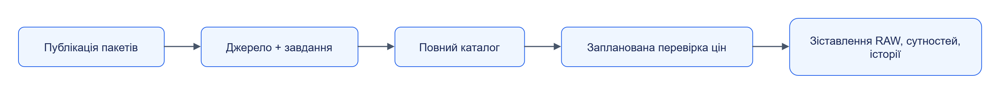

# Перший результат у Jane

Запусти ізольований демонстраційний стек і отримай каталог товарів із локального тестового сайту. Приклад перевіряє збережені дані та часткове оновлення цін.

## Зміст

- [Підготовка](#підготовка)
- [Запуск](#запуск)
- [Перший збір](#перший-збір)
- [Результат](#результат)
- [Telegram](#telegram)
- [Зупинка](#зупинка)

## Підготовка

Потрібні Git, Python 3.12+, uv та Docker з Linux containers; для Admin — Node і pnpm із версією в `web/admin/package.json`. Відкрий термінал у корені Jane. Docker має бути запущений.

```powershell
uv sync --all-packages
uv run --all-packages python examples/jane_examples.py check
```

Offline-перевірка звіряє маніфести, схеми, контрольні приклади й digest. Нуль помилок дозволяє перейти до запуску. Для окремого компонента використовуй його [quickstart](../components/README.md).

## Запуск

```powershell
uv run --all-packages python deploy/profiles/stack.py up --project jane-demo --profile dev-laptop
uv run --all-packages python deploy/profiles/stack.py env --project jane-demo
```

`up` створює окремі контейнери, томи та облікові дані. Порти призначаються на `127.0.0.1`; `env` показує адреси без секретів. Стек містить Registry, Storage, Handler Runtime, Web Collector, Orchestrator, тестовий сайт та їхні залежності. Профіль `dev-laptop` обмежує ресурси кожного сервісу.

## Перший збір

```powershell
uv run --all-packages python examples/jane_examples.py demo --project jane-demo
```



[Темна тема](../diagrams/getting-started/readme-01.dark.png) · [Редаговане джерело Draw.io](../diagrams/getting-started/readme-01.drawio)

Етапи сценарію виконуються через реальні API, а відповіді звіряються з контрактами. Планова перевірка оновлює ціну й наявність, зберігаючи назву та інші поля повного каталогу.

## Результат

У JSON-підсумку очікується:

```json
{"ok": true, "failures": [], "raw_objects": 23, "entities": 16}
```

Повний підсумок містить ID запусків і докази часткового оновлення; файл — `.jane/examples-jane-demo.json`. Дивись `title_observation_kept_from_catalog: true` та `completeness: partial`, а не лише успішний HTTP-статус. Повторна перевірка вже виконаних запусків:

```powershell
uv run --all-packages python examples/jane_examples.py verify --project jane-demo
```

## Telegram

Локальні записи дозволяють пройти шлях повідомлення без облікового запису Telegram:

```powershell
uv run --all-packages python deploy/profiles/stack.py up --project jane-demo --profile dev-laptop --telegram
uv run --all-packages python examples/jane_examples.py telegram --project jane-demo
```

Це recorded backend. Підключення реального акаунта описане в [Telegram Collector](../components/telegram-collector/quickstart.md).

## Зупинка

Наступна команда видаляє контейнери, томи й локальні образи **проєкту jane-demo**, включно з його тестовими даними:

```powershell
uv run --all-packages python deploy/profiles/stack.py down --project jane-demo
uv run --all-packages python deploy/profiles/stack.py leftovers --project jane-demo
```

Очікується порожній `leftovers`. Щоб продовжити працювати з результатами, залиш стек запущеним. Далі: [Admin](admin.md), [посібник користувача](../user-guide/README.md), [діагностика](../operations/troubleshooting.md).
