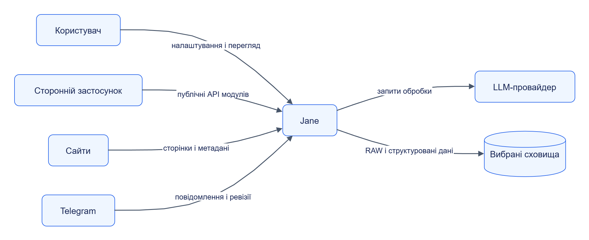

# Огляд Jane

**Jane збирає матеріали, перетворює їх на структуровані дані та передає результат у вибране сховище.** Для цього можна використати один автономний модуль або налаштувати процес із кількох модулів.

## Зміст

- [Для чого використовувати Jane](#для-чого-використовувати-jane)
- [Контекст системи](#контекст-системи)
- [Типи модулів](#типи-модулів)
- [Як налаштовується процес](#як-налаштовується-процес)
- [Можливості та межі](#можливості-та-межі)
- [Що читати далі](#що-читати-далі)

## Для чого використовувати Jane

| Потреба | Налаштування | Результат |
|---|---|---|
| Зібрати каталог товарів | Обхід сайту, екстрактор карток, сховище | Картки з назвою, ціною, наявністю й походженням |
| Перевіряти ціни | Окреме завдання за розкладом, екстрактор вибраних полів | Нові спостереження без стирання інших полів |
| Отримувати події з Telegram | Канали, доступ до Telegram, екстрактор або LLM | Сутності, пов’язані з вихідними повідомленнями |
| Повторити обробку | Вибір збережених RAW і версії пакета | Новий результат із наявних оригіналів |
| Інтегрувати один компонент | Прямий виклик потрібного API | Матеріали або результат обробки у власному застосунку |

Конкретний процес задає користувач. Наприклад, повний каталог і регулярна перевірка цін є двома незалежними завданнями з власними параметрами та розкладом.

## Контекст системи

Схема показує учасників і напрямки взаємодії на рівні платформи. Технічні виклики всередині Jane описані в [архітектурі](../architecture/README.md).

[Темна тема](../diagrams/platform/overview-readme-01.dark.png) · [Редаговане джерело Draw.io](../diagrams/platform/overview-readme-01.drawio)

## Типи модулів

| Тип | Відповідальність | Реалізації |
|---|---|---|
| Колектор | Отримує матеріали з джерела | [Web Collector](../components/web-collector/README.md), [Telegram Collector](../components/telegram-collector/README.md) |
| Обробник збереження | Записує RAW та результати через адаптер | [Storage](../components/storage/README.md) |
| Обробник LLM | Викликає модель із налаштованим підключенням і бюджетом | [LLM](../components/llm/README.md) |
| Середовище виконання | Виконує екстрактор або Python-перетворення | [Handler Runtime](../components/handler-runtime/README.md) |
| Репозиторій пакетів | Зберігає версії, артефакти та походження | [Registry](../components/registry/README.md) |
| Оркестратор | Передає дані між етапами й керує виконанням | [Orchestrator](../components/orchestrator/README.md) |
| Асистент | Досліджує джерело та готує зміни пакетів | [Assistant](../components/assistant/README.md) |
| Адміністративний інтерфейс | Налаштовує процеси й показує результати | [Admin](../components/admin/README.md) |
| Бібліотека або SDK | Дає спільні засоби сервісам та авторам екстракторів | [Jane Kit](../components/jane-kit/README.md), [Extractor SDK](../components/extractor-sdk/README.md) |

**Екстрактор** — пакет із логікою витягування сутностей. **Handler Runtime** — сервіс, який виконує код цього пакета. Власний застосунок може передати йому локальний пакет і матеріал без Orchestrator та Registry.

## Як налаштовується процес

1. Вибрати джерело й правила збору.
2. Вибрати версії пакетів і побудувати етапи обробки.
3. Налаштувати підключення до сховищ або LLM.
4. Задати розклад, ліміти та правила повторних спроб.
5. Запустити процес і перевірити матеріали, результати та діагностику.

Збереження RAW є окремим етапом. Гілки завдання можуть передавати той самий матеріал на збереження й екстракцію. Подальший етап отримує результат попереднього за заданими зв’язками, умовами та типами входу.

Пакет прив’язується до конкретної версії. Оновлення публікується новою версією; форк має власну історію. Assistant може підготувати зміни за участю LLM, а порядок їх погодження й активації визначає налаштування.

## Можливості та межі

| Область | Реалізована основа | Що врахувати |
|---|---|---|
| Web | Рекурсивні посилання, Sitemap, RSS/Atom, шаблони URL, listing та API feed | Правила області обходу, robots і ліміти джерела; [стратегії](../../services/web-collector/strategies/discovery/) |
| Telegram | Збір, історія, редагування та вкладення | Реальний доступ потребує налаштованої Telegram-сесії; [налаштування](../../services/telegram-collector/src/jane_telegram_collector/settings.py) |
| Збереження | Адаптери PostgreSQL, SQL Server, MongoDB, MinIO, S3, файли | Реальне підключення та права на ціль; [адаптери](../../services/storage/adapters/) |
| Python | Виконання пакета в контейнерній пісочниці | Дозволений профіль бібліотек і ресурсів; мережа вимкнена в Docker backend |
| LLM | Gateway, бюджети, fake і Anthropic-провайдери | Моделі, ціни й облікові дані задаються підключенням; [провайдери](../../services/llm/src/jane_llm/providers/) |
| Великі матеріали | Inline-вміст або перевірений ContentRef | Спільний том чи дозволений download URL; [передавання даних](../architecture/data.md#передавання-вмісту) |
| Кілька екземплярів | Leases і спільний стан | Memory-режими не зберігають стан після перезапуску; SQLite колекторів потребує спільного файлу |

Файлова система й сховище службового стану модуля мають окреме призначення від цільового сховища бізнес-даних. Умови масштабування наведені в [розгортанні та лімітах](../architecture/deployment.md).

## Що читати далі

| Питання | Документ |
|---|---|
| Як називаються основні поняття? | [Терміни](glossary.md) |
| Який модуль потрібен? | [Каталог модулів](../components/README.md) |
| Як побудовано Jane? | [Архітектура](../architecture/README.md) |
| Де лежить код? | [Карта репозиторію](../architecture/repository-map.md) |
| Як отримати перший результат? | [Швидкий старт](../getting-started/README.md) |
| Які вимоги визначають систему? | [Технічне завдання](../../TECHNICAL_SPECIFICATION.md) |

Опис звірено з кодом, контрактами й конфігурацією ревізії `91876d1` від 2026-10-11. Межі статичної перевірки зафіксовано у [звіті DOC-04](../delivery/documentation/DOC-04.md).
