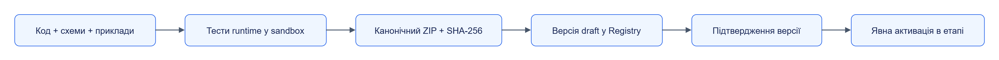

# Пакети обробників

Пакет містить одну версію логіки обробки, схеми та контрольні приклади. Registry зберігає версії; відповідний виконавець запускає пакет. Етап завдання посилається на пакет, версію та digest.

## Зміст

- [Типи пакетів](#типи-пакетів)
- [Будова](#будова)
- [Створення екстрактора](#створення-екстрактора)
- [Перевірка та виконання](#перевірка-та-виконання)
- [Публікація](publishing.md)
- [Версії та форки](versions.md)

## Типи пакетів

| `kind` | Вміст | Виконавець |
|---|---|---|
| `extractor` | Python, схема параметрів і сутностей | [Handler Runtime](../../components/handler-runtime/README.md) |
| `transform` | Python або посилання на виконавця | Handler Runtime чи сумісний `handler.v1` |
| `storage` | Адаптер, режим запису, формат | [Storage](../../components/storage/README.md) |
| `llm` | Інструкції, шаблон входу, схема відповіді | [LLM](../../components/llm/README.md) |
| `collector-rules` | Правила пошуку й фільтрації | Відповідний [колектор](../../components/README.md) |

Форму полів визначає [package-manifest.schema.json](../../../contracts/schemas/package-manifest.schema.json), відповідність `kind` та `entry` додатково перевіряє [PackageValidator](../../../services/registry/src/jane_registry/validation.py). Пакет не містить секретів: потрібні підключення оголошуються через `required_connections`.

## Будова

```text
package/
├── jane-package.json
├── src/simple_product/main.py
├── schemas/params.schema.json
├── schemas/product.schema.json
└── tests/
    ├── product/input.txt
    ├── product/expected.json
    └── empty/input.txt
```

Шляхи відносні, з `/`, без `..` і симлінків. Registry нормалізує ZIP: відсортовані шляхи, фіксовані час і права, без стиснення. SHA-256 обчислюється від цих канонічних байтів, тому digest довільно створеного ZIP може відрізнятися.

## Створення екстрактора

Готовий мінімальний пакет — [documentation.simple-product](../../../examples/documentation/minimal-package/jane-package.json). Скопіюй його в робочу папку, зміни `package_id`, `title` та схему виходу. Не редагуй опубліковану версію: наступна зміна має новий `version`.

Його функція читає рядок `SKU|назва` і повертає сутність:

```python
def extract(material: Material, params: dict[str, Any], ctx: Context) -> ExtractResult:
    parts = ctx.text().strip().split("|", 1)
    if len(parts) != 2 or not all(parts):
        return empty()
    sku, title = parts
    return success([entity("product", {"sku": sku, "title": title})])
```

Імпорти й повний код — [main.py](../../../examples/documentation/minimal-package/src/simple_product/main.py). SDK надає `Context`, `empty`, `entity`, `success`; runtime додає ключ зі `sku`, observation і provenance та перевіряє схему полів. Відсутнє поле зберігає попереднє значення; явне очищення задається `cleared`.

## Перевірка та виконання

Передумови: Python із залежностями workspace, Docker у режимі Linux containers. Команди виконуються в корені Jane; повний стек і Registry не потрібні.

```powershell
uv sync --all-packages
uv run --package jane-handler-runtime jane-handler-runtime build-image
uv run --package jane-handler-runtime jane-handler-runtime test examples/documentation/minimal-package
uv run --package jane-handler-runtime jane-handler-runtime run examples/documentation/minimal-package examples/documentation/minimal-package/tests/product/input.txt --media-type text/plain
```

Тести мають дати `2 passed, 0 failed`. Остання команда повертає `status: success` і сутність `product` із `sku: A-100`, `title: Desk lamp`; випадок `empty` повертає порожній список. Виняток у функції стає `failed`, невідомий формат можна явно повернути як `unrecognized`. Без мережі та змінного часу результат відтворюється.



[Темна тема](../../diagrams/packages/readme-01.dark.png) · [Редаговане джерело Draw.io](../../diagrams/packages/readme-01.drawio)

Стрілки показують порядок підготовки пакета. Публікація й активація — окремі операції; тестування не змінює етап завдання.

Подальші кроки: [публікація та перевірка digest](publishing.md), [сумісність і форки](versions.md), [SDK](../../components/extractor-sdk/README.md).
