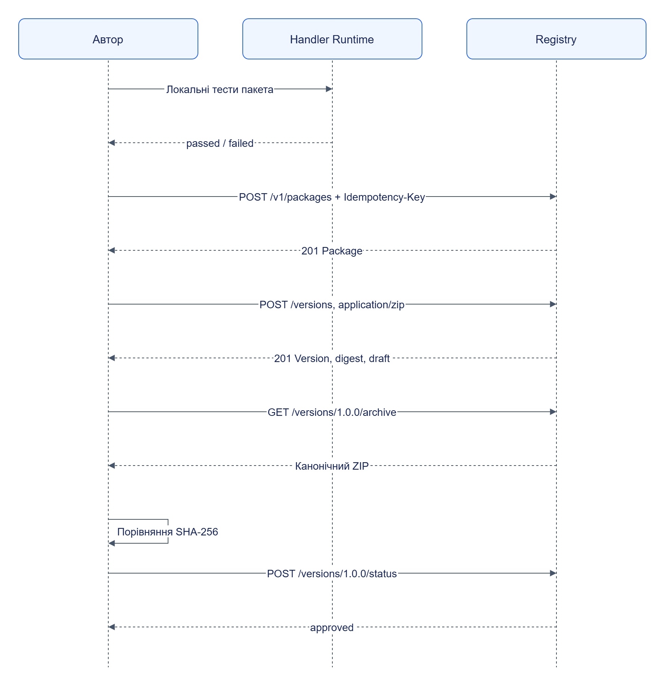

# Публікація пакета

Публікація створює незмінну версію в Registry. Використовуй [готовий приклад клієнта](../../../examples/documentation/publish_package.py): він читає токен із локального stack-файла, перевіряє відповіді за OpenAPI та порівнює digest завантаженого архіву.

## Послідовність



[Темна тема](../../diagrams/packages/publishing-01.dark.png) · [Редаговане джерело Draw.io](../../diagrams/packages/publishing-01.drawio)

`approved` не змінює прив’язки завдань. Активація виконується через API Orchestrator і перевірку сумісності етапу. Для пакета, який використовують різні завдання, перевір усі прив’язки або створи незалежний форк.

## Відтворення

У корені Jane після запуску [демонстраційного стеку](../../getting-started/README.md):

```powershell
uv run --all-packages python examples/documentation/publish_package.py --project jane-demo --package examples/documentation/minimal-package
```

Очікується JSON із `package_id`, `version`, `digest`, `download_digest_matches: true`. Повторна публікація однакової версії може повернути `409`; клієнт читає наявну версію та перевіряє її digest. Інший вміст із тим самим номером версії — помилка.

## Помилки

| Ознака | Дія |
|---|---|
| `validation_failed` | Перевір форму `entry`, схеми й посилання на файли |
| `secret_detected` | Прибери значення секрету, використовуй `required_connections` |
| `version_exists` | Зміни версію; не замінюй вже опубліковані байти |
| Невідомий runtime profile | Звір `dependencies` із `/v1/info` runtime та Registry |
| Тест не пройшов | Виправ код або очікування згідно з вимогами, повтори тест |

Точні HTTP-статуси й параметри — [API Registry](../../components/registry/reference/api/README.md).
