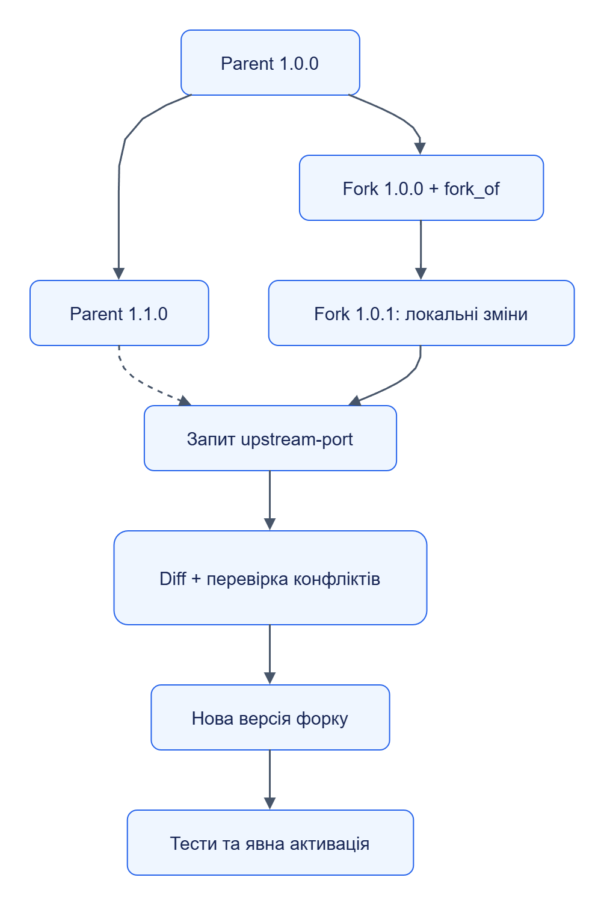

# Версії, походження та форки

Версія пакета незмінна. `package_id` ідентифікує лінію розвитку, `version` — SemVer, `digest` — конкретні байти канонічного ZIP.

## Сумісність

| Зміна | Рекомендований номер | Що перевірити |
|---|---|---|
| Виправлення селектора без зміни схеми | patch | Старі й проблемний контрольні приклади |
| Нове необов’язкове поле | minor | Схеми та споживачі виходу |
| Зміна ключа або обов’язкового поля | major | Переприв’язка й збереження даних |

Це правила авторства; Registry перевіряє форму SemVer, а сумісність конкретної обробки підтверджують тести. У `provenance` зазначай `created_by`, `change_summary`, за потреби `based_on` і метадані LLM. Runtime profile визначає дозволені бібліотеки; вимога залежності не встановлює довільний пакет у sandbox.

## Форк і перенесення змін

`POST /v1/packages/{package_id}/forks` створює новий пакет із `fork_of`. Він отримує окремі версії й політику автооновлення. Батьківське оновлення не змінює форк автоматично.

[Темна тема](../../diagrams/packages/versions-01.dark.png) · [Редаговане джерело Draw.io](../../diagrams/packages/versions-01.drawio)

Пунктир — запропоноване перенесення батьківських змін. API `upstream-ports` створює кандидат; конфлікти та тестові результати треба перевірити перед активацією. Операції й тіла запитів наведені у [довіднику Registry](../../components/registry/reference/api/README.md).

## Відкат

Не видаляй використану версію й не змінюй її байти. Активуй попередню сумісну версію в етапі через операцію rollback Orchestrator. Уже виконаний запис у сховище від цього не скасовується; виправлення даних виконується окремим запуском або відновленням власника сховища.
