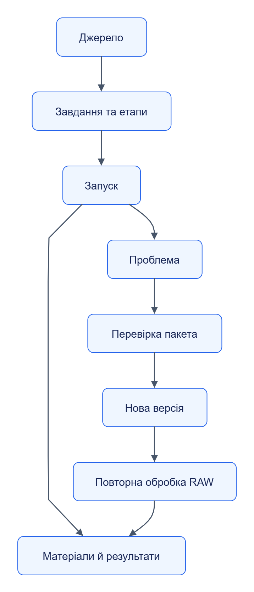

# Посібник користувача

Описує роботу через Admin: від джерела й завдання до результату та повторної обробки. Почни з [демонстрації](../getting-started/README.md); кожний сценарій працює з її тестовими даними.

| Потрібно | Сторінка | Результат |
|---|---|---|
| Додати джерело й налаштувати збір | [Джерела та завдання](sources-tasks.md) | Збережене й перевірене завдання |
| Змінити розклад і стежити за запуском | [Розклади та запуски](runs-schedules.md) | Запуск із зрозумілим станом етапів |
| Перевірити або оновити обробник | [Пакети й екстрактори](packages.md) | Тести, нова версія та активація |
| Підключити модель або допомогу асистента | [LLM та Assistant](llm-assistant.md) | Контрольована сесія з бюджетом |
| Знайти дані або причину збою | [Результати й проблеми](results-problems.md) | Походження, діагноз або reprocess |

[Темна тема](../diagrams/user-guide/readme-01.dark.png) · [Редаговане джерело Draw.io](../diagrams/user-guide/readme-01.drawio)

Схема показує робочий процес користувача. Між сервісами дані проходять за [архітектурою виконання](../architecture/execution.md).
