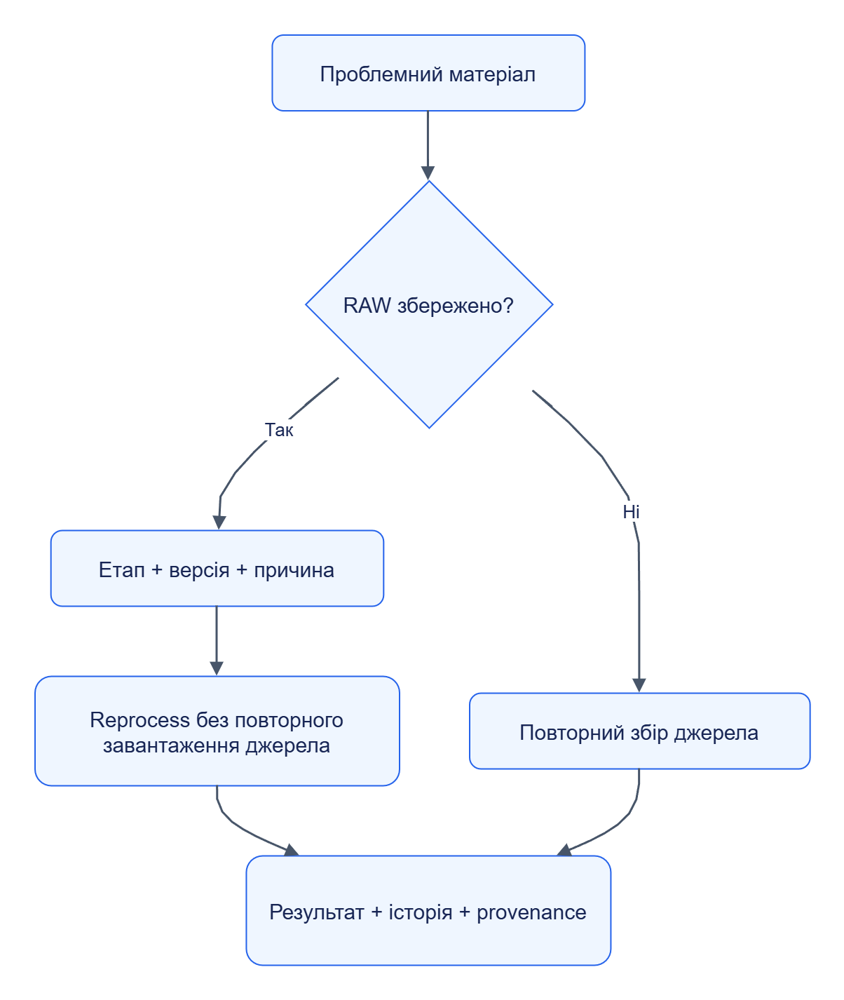

# Результати й проблеми

Результат має простежуватися до матеріалу, запуску та версії пакета. Проблема містить конкретну причину й достатній приклад для відтворення.

## Знайти результат

У **Результати** вибери підключення й тип сутності `product`, відкрий товар. Перевір поля, natural key, observation, provenance та історію. Після `testsite-price-check` ціна й наявність мають нове походження, а назва — залишатися з повного каталогу.

У **Матеріали** відкрий RAW, його метадані та шлях через етапи. Великий вміст завантажується за посиланням; preview може бути обмежений розміром.

## Знайти причину збою

У **Проблеми** відфільтруй джерело й пакет; відкрий групу та зразок. Розрізняй `empty` (матеріал зрозумілий, сутностей немає), `unrecognized` (формат не розпізнано) і `failed` (виконання зірвалося). Перевір код помилки, diagnostics, історію спроб і effective limits.

## Повторна обробка

Вибери збережені RAW, завдання та початковий етап у формі reprocess. Задай причину, перевір активну версію пакета та виконай запуск. Після завершення зістав кількість оброблених матеріалів і походження нових сутностей.

[Темна тема](../diagrams/user-guide/results-problems-01.dark.png) · [Редаговане джерело Draw.io](../diagrams/user-guide/results-problems-01.drawio)

Повторний збір може отримати інший вміст джерела. Reprocess використовує збережений матеріал; потрібні доступне сховище та сумісний ContentRef. Конкретні помилки й дії — [діагностика](../operations/troubleshooting.md).
