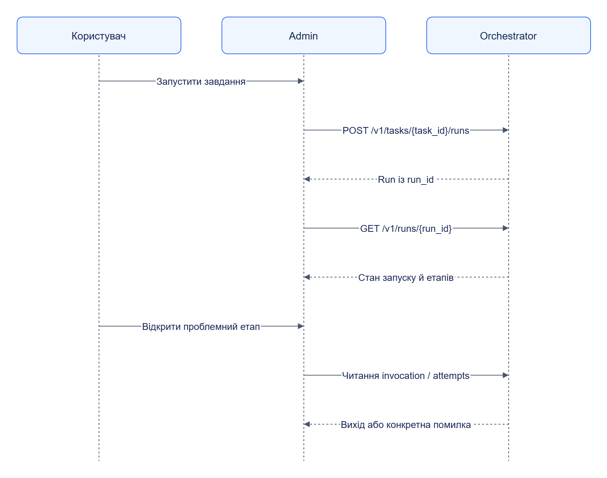

# Розклади та запуски

Розклад визначає наступний запуск завдання; сторінка запуску показує стан колектора, етапів і повторів.

## Розклад

У **Завдання** відкрий `testsite-price-check` і редактор розкладу. Обери інтервал або cron, часову зону, початок і політику перекриття. Збережи та відкрий завдання повторно: переконайся, що значення збережені й наступний час виконання очікуваний.

Cron та часові зони реалізовані у [schedule.py](../../services/orchestrator/src/jane_orchestrator/schedule.py). UTC-час API і локальний час інтерфейсу не слід змішувати.

## Запуск і спостереження

Натисни запуск у картці завдання. У **Запуски** відкрий створений ID; переглянь етапи DAG, кількість матеріалів, invocation і помилки. За довгої операції інтерфейс опитує job із backoff.

[Темна тема](../diagrams/user-guide/runs-schedules-01.dark.png) · [Редаговане джерело Draw.io](../diagrams/user-guide/runs-schedules-01.drawio)

Схема показує лише взаємодію Admin та Orchestrator. Виконавців опитує Orchestrator, як у [execution](../architecture/execution.md).

## Скасування та повтор

Скасовуй активний запуск у його картці. Запит на скасування й остаточний `cancelled` — різні події: дочекайся завершення. Для повтору відкрий історію спроб і перевір, чи помилка retryable. Повторна обробка збережених RAW описана в [результатах і проблемах](results-problems.md).
